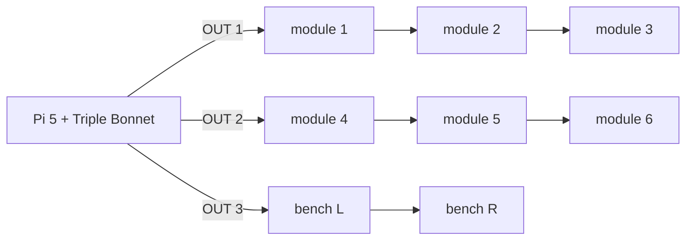
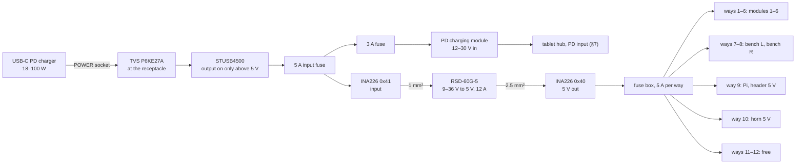
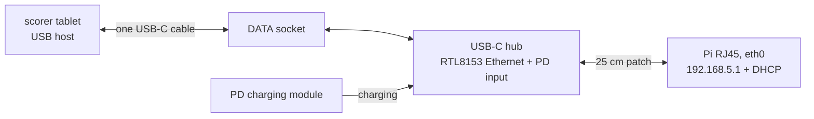

# Point Hub board — DIY scoreboard build guide (KSCW)

How KSC Wiedikon builds its own scoreboard from open parts: the same 192 × 64 pixels as the
Tech4Sport LedBox C0270 at **1.67× its pitch**, a small score panel facing each bench, a 10.1″
touchscreen for the scorer in the back, powered by **USB-C only** and driven by the same open software
stack (bridge, console, openscore, flushBuffer2).

This page describes **design D**, the version that is being built: a fixed 22 cm box whose **front
panel tilts** 0–20° towards the first referee, and a **screen flap** in the back panel. It is written
so that a club member can buy, build and run a board alone.

> **Status, 2 November 2026: parts ordered, wood ordered, not built yet.** Nothing in design D has
> been assembled, and the LED driver for the Raspberry Pi 5 is not written yet (§10.7). Items marked
> **Check** are not tested or not decided: do them in the order this guide gives, and do not rely on
> a part of the design before its check has passed.
>
> Prices are **approximate, CHF, October 2026**, from the club's own shopping list. LED modules and
> Raspberry Pi prices move a lot; check at purchase time. Orders from outside Switzerland add import
> VAT and fees — put them in as few parcels as possible.

**The illustrated build manual** (<https://claude.ai/artifact/Pezf9GMMEMuS1Kdg7xmxa8>, generated from
`docs/diy-panel/guide/`) shows design D in 3D (tilt the front, open the flap, pull the foot out) and
in 27 drawn steps, with the same part letters as this page. Read the two side by side; for numbers
and wiring, this page is the reference.

This guide replaces the earlier recipe for a 1× panel (three 64×64 modules on a 230 V mains supply),
which is withdrawn; it is in the git history if you need it.

---

## How to use this guide

### Order of work

| # | Stage | Where | Section |
|---|---|---|---|
| 1 | **Buy** the parts and check the tools | online + one DIY-store trip | §2, §3 |
| 2 | **Bench test** one LED module on the Pi (before anything is cut) | home | §10.2 |
| 3 | **Cut**: the plywood comes cut to size from Jumbo; windows, openings, holes, metal parts at an open workshop | GZ workshop | §8, §9 A |
| 4 | **Dry fit** the whole case with tape and a few screws, no glue | GZ workshop or home | §9 B |
| 5 | **Glue** the shell and the small assemblies | home | §9 C |
| 6 | **Paint** | GZ workshop (if allowed) or a balcony | §9 D |
| 7 | **Electronics**: power path first, then everything else | home | §5, §9 E |
| 8 | **Software** bring-up, touchscreen and flicker test | home | §10 |
| 9 | **Bench checklist** before the first match | home, then the hall | §6 |

**Where to work.** Sawing, hole saws, metal work and rough sanding make dust and chips: do them in a
Zürich community-centre open workshop. **GZ Hirzenbach** has a wood and a metal workshop (Tuesday
14–21, Saturday 11–17; your own tools and material are allowed); **GZ Bachwiesen** has a wood
workshop (Tuesday–Friday). Check the opening hours and rules with the GZ before you go. Gluing,
wiring and soldering are done at home: no dust, and ventilate the room when you solder. Paint at the
workshop if they allow it, otherwise outside on a balcony with a drop sheet.

**Time.** The earlier, simpler design was estimated at 12–15 h. Design D adds the tilting front,
the screen flap and the pull-out foot, so plan on roughly **20–25 h of work**: about three workshop
sessions for cutting and metal work, and several evenings at home for gluing, wiring and software,
plus a day per paint stage for drying and about a week before the paint is hard enough for the
rubber pads. This is an estimate — nobody has built a design-D board yet.

**Words and letters.** All sizes are in **millimetres** (W × H × D, or length × width). The
plywood parts have letters, the same as on the cutting sheet: **A** front frame, **B** back panel,
**C1** top, **C2** bottom, **D** ends, **F** screen flap, **P1–P3** flap pocket, **K** bottom cap,
**H** side cheeks, **Y** backing plates, **T** pull-out foot. Other parts are named in words.

### What still needs checking

These have **not been tested** or **not been decided**. The guide marks each one where it comes up.

| Check | What could go wrong | When | Section |
|---|---|---|---|
| **First light on the Pi 5 + Piomatter** | **Passed 4 Nov 2026** with one module. Still open: all eight modules, Ports 2 and 3 | before cutting | §10.2 |
| **Screen flicker test** | the touchscreen makes the LED modules flicker → the screen stays out, the scorer uses a tablet on the DATA cable | before fitting the screen | §10.4 |
| **Bottom cap K vs backing plates Y** | both want the front/centre of the floor | dry fit, before gluing Y | §8.6 |
| **Soak test** (2 h at the power cap) | the box runs too hot | before the first match | §6 |
| Cheeks H and stays vs the bench modules | the parts that close the side gaps may hit the bench modules | dry fit | §8.4 |
| Polycarbonate sheet vs battens on A | the front sheet was cut for the earlier frame and may overlap the battens | dry fit | §8.3 |
| Piano hinge position | A's top corner must clear the top C1 when tilting | dry fit | §8.4 |
| Pull-out foot rails | rail length and height | dry fit | §8.8 |

---

## 1. What it is

| | |
|---|---|
| Main screen | **192 × 64 LEDs at 5 mm pitch** (6 modules of 64×32, P5), 960 × 320 mm, behind 3 mm smoked polycarbonate |
| Bench panels | **2 × (32 × 64)**: one P5 module per end, upright, facing the benches |
| Box | **1020 × 380 × 220 mm** (W × H × D), 6 mm poplar plywood, about **8.5 kg** |
| Front | the **front panel tilts 0, 5, 10, 15 or 20°**: it hangs from a piano hinge along the top edge and its bottom swings out, so the screen leans back towards the first referee. No legs; the box itself never moves |
| Scorer screen | **10.1″ touchscreen** (1280 × 800) in a flap in the back panel, hinged at its top, swings out like an awning — **Check:** only if the flicker test passes (§10.4) |
| Power | **USB-C PD charger, 18–100 W**; 65 W or more for full brightness while charging the tablet |
| Ports | **2 × USB-C, nothing else**: POWER and DATA (to the scorer tablet: network + charging), low on the back under the flap |
| Wi-Fi | **out only**: the Pi's built-in radio joins the hall's Wi-Fi for internet; the board has no Wi-Fi network of its own |
| Mounting | table (rubber pads + pull-out rear foot against tipping), 35 mm speaker stand, tripod or light stand (¼″ or ⅜″, rated 12 kg+) |
| Horn | **fitted**: a 5 V piezo buzzer, about 95 dB, switched over I²C |
| Computer | **Raspberry Pi 5** (8 GB) with the Active Cooler; fallback Pi 4 2 GB (§10.2) |
| Use | **indoor only** — the outdoor C0270 stays the beach board |
| Parts | about **CHF 850** with the screen and splash protection, each part where it is cheapest (October 2026), plus shipping; without the Pi 5 and without tools |

**Why this size.** Keeping 192 × 64 pixels means every existing layout renders unchanged; only
the pitch grows, from the C0270's ~3 mm to 5 mm. A score digit (fontsize 55, about 40 px) becomes
about **20 cm** tall instead of about 12 cm. A 1.5× box is not possible (there is no 4.5 mm pitch),
and 2× would mean twelve P3 modules with a 2× upscale: more cost and more power than USB-C
delivers.

**Why the front tilts.** From a scorer's table about 10 m away, the first referee's eyes are 10–15°
above the board. Tilting only the front panel keeps the box 22 cm deep (it fits a scorer's table or
the top of a vaulting box) and keeps the top edge flush, so nothing hides the top row of the score.

**The bench panels** show the score to each bench (own team on top, timeouts and substitutions).
openscore draws them itself from the live match sections, so the bridge, the console and the
protocol stay unchanged (§10.7). They sit in the fixed ends and do not tilt.

**Software:**

```
console + bridge  ──TCP 8889──▶  openscore  ──buffer.png──▶  flushBuffer2  ──3 × HUB75──▶  8 modules
 (unchanged)                    (renderer)                  (panel driver, power governor)
```

---

## 2. Bill of materials

Quantities include the spares that live in the box (2 modules, 4 fuses, 1 SD card). Shops are the
ones the club used in October 2026; "DIY store" means Jumbo, Hornbach, OBI or Coop Bau+Hobby.
**Check** in the price column means no price was recorded: look it up.

### 2.1 Wood, sheet and bar material

| Part | Spec | Qty | Where | ~CHF |
|---|---|---|---|---|
| Plywood, cut to size | **Oecoplan poplar 6 mm (A/B)**, Jumbo online cut-to-size; the 15 pieces of the cut list (§8.2) | 1 order | Jumbo (online, store pickup) | 54 |
| Battens | **beech 15 × 20 mm, 1 m** (15 × 15 is not stocked in Zürich): 2 long battens, 2 foot rails, 2 tray posts of 362 mm, blocks, 1 spare | 5 | DIY store | Check |
| Polycarbonate, smoked | 3 mm **Makrolon UV 2760 grey** (about 62 % light), cut to 990 × 350 × 1 and 172 × 332 × 2. Not acrylic: a ball can crack it | 1 set | acrylglas-shop.com (ships to DE/AT only) or kunststoff-shop.ch (51 % light, ~CHF 89) | 42 |
| Steel flat bar | **20 × 4 mm steel**, 1 m — must be steel, the module magnets hold on it; cut 3 bars of 360 mm (§8.3), two per 1 m bar | 2 | Hornbach.de or any DIY store | 3–5 each |
| Aluminium flat bar | **25 × 4 mm**, 1 m, for the two ratchet stays (steel also works) | 1 | Hornbach.de or DIY store | 8 |
| Aluminium sheet | **2 mm, 200 × 400**: the **electronics tray** (§8.11) — converter, fuse box, Pi and the small boards all on one removable upright plate | 1 | Hornbach.de (or 1.5 mm from OBI) | 17 |

### 2.2 LED modules and computer

| Part | Spec | Qty | Where | ~CHF |
|---|---|---|---|---|
| LED module | P5 64 × 32 indoor to the purchase spec in §3; **8 + 2 spare, one batch** | 10 | AliExpress · Yao Cai Xing Official Store | 185 |
| Magnets | M3 magnetic screws, about Ø12–13 mm, 8–12 mm high (size "1313" or similar), 4 per module; the seller does not include them | 40 | AliExpress (2 packs of 20) | 12 |
| Raspberry Pi | **Raspberry Pi 5, 8 GB** | 1 | the club's own; otherwise any Pi shop | Check |
| Cooler | **Raspberry Pi Active Cooler** (SC1148): the Pi 5 runs hot in a closed box | 1 | DigiKey CH | 6 |
| Fallback Pi | Raspberry Pi 4, **2 GB** — buy only if the Pi 5 bench test fails (§10.2) | (1) | welectron, pi-shop.ch | 60 |
| Driver board | **Adafruit Triple LED Matrix Bonnet (6358)**, 3 HUB75 outputs — not the single bonnet 3211 | 1 | DigiKey CH | 9 |
| Stacking header | Adafruit 1979, extra-tall 2 × 20, between Pi and bonnet | 1 | DigiKey CH | 3 |
| Standoffs | M2.5 brass standoff kit, about 11 mm (Pi, bonnet, small modules), plus **M3 × 10 mm** brass standoffs and short M3 screws for the hub board and anything with M3 holes | 1 + 1 | AliExpress | 6 + 3 |
| Cable-tie mounts | self-adhesive cable-tie mounts, about 20 × 20 mm, and small cable ties: hold every lead flat on the tray, clear of the fan | 1 pack | AliExpress or any DIY store | 3 |
| microSD | 32 GB, prepared image; one spare | 2 | Galaxus | 14 |

### 2.3 Scorer screen

| Part | Spec | Qty | Where | ~CHF |
|---|---|---|---|---|
| Touchscreen | **Waveshare 10.1inch DSI LCD (C)**, 1280 × 800, capacitive touch (Waveshare SKU 23450). Not the 800 × 1280 "10.1-DSI-TOUCH-A" | 1 | AliExpress Waveshare store or eckstein-shop.de | 80–85 |
| Display cable | **Raspberry Pi display cable, standard–mini, 300 mm** (SC1132): the Pi 5 has the small 22-pin connector, the screen the standard 15-pin one; the length makes the loop at the flap hinge | 1 | DigiKey CH | 3 |
| Torque hinges | constant-torque (friction) hinge, black, **1.2 N·m**, 38 × 40 mm, along the top edge of the flap | 2 | AliExpress Choice | 10 |
| Magnetic catches | **Hettich 27 × 18 mm, screw-on, 2 kg, adjustable**: for the flap and the back panel | 6 | DIY store | Check |

### 2.4 Tilting front and anti-tip

| Part | Spec | Qty | Where | ~CHF |
|---|---|---|---|---|
| Piano hinge | steel, about **1000 × 32 mm**, along the top front edge | 1 | Hornbach.de or DIY store | 10–15 |
| Cap hinge | hinges the bottom cap K to A's bottom edge so K can follow the floor: 3 small butt hinges about 50 mm (e.g. Hettich Slim Hinge 50, black), with 3 × 12 countersunk wood screws. Glue a 6 mm plywood **doubler** (about 60 × 30) under each leaf on K and on A, so the screws have 12 mm of wood and do not come through | 3–4 | Jumbo | 10 |
| Stay pins | **M6 × 30 hex bolt + M6 nylon lock nut** (or M6 shoulder bolts) | 2 | DIY store | 4 |
| Rubber pads | self-adhesive **clear rubber pads 20 × 20**, about 3 mm (not felt): 4 under the box, 2 under the back end of the foot, 2 spare | 8 | DIY store | 5 |
| Handles | **K16 recessed spring handle**, black steel, rubber grip, springs back flush. Rim 155 × 83.3 × 1.2 mm, cut-out 129 × 52 mm, 6 × Ø4.8 holes | 2 | AliExpress ("K16 folding automatic rebound … box handle") | 12 incl. shipping |

### 2.5 Power

| Part | Spec | Qty | Where | ~CHF |
|---|---|---|---|---|
| Converter | **Mean Well RSD-60G-5** exactly: 9–36 V in, 5 V 12 A (60 W) out. Not DDR-60G-5, not RSD-60L/-60H | 1 | DigiKey CH | 39 |
| USB-C PD sink board | **STUSB4500**, SparkFun DEV-15801 (output switches on only after a contract; I²C `0x28`) | 1 | DigiKey CH | 29 |
| Fuse box | 12-way **standard blade (ATO/ATC)** with a common + feed, a negative bus and a cover | 1 | Amazon.de (not sold in Swiss shops) | 15 |
| Blade fuses | 14 × ATO 5 A (4 spare); 2 × MINI 5 A and 2 × MINI 3 A for the inline holders | 1 set | reichelt or a car-parts shelf | 4–10 |
| Inline fuse holders | MINI blade, leads ≥ 1 mm²: one 5 A input fuse, one 3 A charging fuse | 2 | Conrad.ch | 4 |
| TVS diode | **P6KE27A** through-hole (not P6KE22A, whose standoff is only 18.8 V), or SMBJ22A SMD | 5 | reichelt | 1 |
| Small parts | 10 kΩ ¼ W resistor (OE pull-up, §4.2), 2 clip-on ferrites 6 mm bore | 1 set | reichelt | 6 |

### 2.6 Tablet link

| Part | Spec | Qty | Where | ~CHF |
|---|---|---|---|---|
| USB-C network adapter | **Delock 66644**: RTL8153 Ethernet + USB-C PD charging input, works with Android | 1 | reichelt or Digitec | 32–35 |
| Tablet charging module | USB-C PD buck module, 12–30 V in (**DMyond PD 65 W**, or QIQIAZI PD65W), fed behind the 3 A fuse | 1 (+1 spare) | AliExpress or Amazon.de | 8 |
| Panel-mount USB-C | female panel socket to male plug, 30 cm, all lines wired (CC, D+/D−), Adafruit 6069 | 2 | DigiKey CH | 8 |
| Network cable | Cat 6, 25 cm | 1 | reichelt or any shop | 1–4 |
| Stand cable | **USB-C, 3 m, PD + data**: on a speaker stand or tripod the tablet stays on the scorer's table (about 4 m total at most) | 1 | Galaxus, Digitec or AliExpress | 15 |

### 2.7 Clock, sensors, horn

| Part | Spec | Qty | Where | ~CHF |
|---|---|---|---|---|
| Clock | DS3231 module (ZS-042 type: **remove its charging resistor** before fitting the cell) + **CR2032** (Varta; buy cells in Switzerland, AliExpress cells are often fake) | 1 | AliExpress + Migros/Coop/Digitec | 9 |
| Temperature sensor | **SHT40**, Adafruit 4885 (own pull-ups) | 1 | DigiKey CH | 5 |
| Current sensors | **3 × INA226 board with an R002 (2 mΩ) shunt** and a 3-way screw terminal VIN+ / VBUS / VIN− (red board, “INA226 · R002” variant; not R100, not INA228/238): one in the 5 V lead from the converter (up to 12 A), one behind the 5 A input fuse, one spare. 2 mΩ still resolves about 1.25 mA, plenty for the self-test. Both come as `0x40`: on the input board bridge **A0 to VCC** for `0x41` | 3 | AliExpress · Shenzhen Tengsheng Technology (not Choice, CHF 3.73 shipping) | 7 + 4 |
| Horn switch | **MCP23017 module** (CJMCU-2317 style; MCP23017, not the SPI MCP23S17), I²C `0x20` | 1 | AliExpress · Suzpng Limited Store | 6 incl. shipping |
| Horn MOSFET | **isolated MOSFET module, variant AOD4184** (optocoupler input; not FR120N, LR7843 or an IRF520 module) | 1 | AliExpress Choice | 4 |
| Horn | **SFM-27 active piezo buzzer, continuous** (not the "-II" intermittent type), DC 3–24 V, about 95 dB, about 30 mm across, with mounting ears | 1 (+spares) | AliExpress Choice (pack of 5) | 3 |
| Status lights | **STATUS** and **LINK**: **RGB 5 mm LEDs, common cathode, matte**; resistors 150 Ω (red) and 47 Ω (green, blue); 2 × **panel-mount 5 mm metal LED holders** for Ø8 holes. POWER is the ring of the button below. Wiring and colour codes in §6 | 1 set | AliExpress · CHANZON (LEDs “100PCS 5mm Matte CC”, holders “5mm Metal”) + a resistor kit | 15 |
| Power button + POWER light | **16 mm self-reset push button with a green 6 V ring**, panel mount, Ø16 hole, + 2-pin header for the Pi 5's power-button pads (J2). The ring on 5 V is the POWER light | 1 | AliExpress | 3 |

### 2.8 Wiring

| Part | Spec | Qty | Where | ~CHF |
|---|---|---|---|---|
| Silicone wire | red + black, 14 AWG (≈ 2.1 mm², the converter-to-fuse-box run), 16 AWG (≈ 1.3 mm²), 18 AWG (≈ 0.8 mm²) | 1 set | Amazon.de | 25 |
| Lever connectors | Wago 221-413 | 20 | reichelt or Brack | 11 |
| Ferrules | 0.75–2.5 mm²; 400 come with the crimper in the tool list | 1 set | with the crimper | — |
| Heat-shrink | 2:1 assortment | 1 | with the tools | — |

### 2.9 Case hardware and mounting

| Part | Spec | Qty | Where | ~CHF |
|---|---|---|---|---|
| Wood screws | **3.5 × 16 mm Torx T20, black** (Spax BLAX), about 100 | 1 pack | Hornbach.de or OBI | 6–10 |
| Machine screws | **M4 × 16 pan head Torx T20, A2 stainless** (ISO 14583): 12 for the handles, plus the hinges and the flange | about 30 | Schraubenking.ch | 3 |
| Lock nuts | M4, DIN 985 (nylon insert) | 1 pack of 100 | Hornbach | 3–5 |
| Stand flange | **35 mm speaker-stand flange K&M 195/8** with its clamp screw; M8 bolts through the 12 mm backing plate | 1 | Thomann.ch | 21 |
| Tripod threads | threaded inserts for wood, **¼″-20 and ⅜″-16** UNC, hex drive, 13–15 mm long (sold in lots of 10) | 1 each | AliExpress | 7 |
| Turn buttons | small flat turn buttons with screws: 4 per bench module, 1 for the foot, some for the back panel | about 12 (pack of 50) | AliExpress | 2 |
| Corner caps | black rubber, front corners only; **trim them to the ends' 6 mm edge** — a cap that wraps onto the front face stops A from tilting | 4 | AliExpress | 3 |
| T20 key | plain Torx T20 L-key for the kit bag (opens the back panel) | 2 | AliExpress | 1 |

### 2.10 Glue, finish, splash protection

| Part | Spec | Qty | Where | ~CHF |
|---|---|---|---|---|
| Wood glue | **water-resistant D3 PVA** (UHU Holzleim wasserfest); open time about 10 min | 1 | DIY store | Check |
| Painter's tape | for glue-ups (instead of clamps) and masking | 2 rolls | DIY store | Check |
| Wood filler | fine, for screw holes and edges | 1 | DIY store | 5 |
| Spray filler, grey | fills the plywood grain on the front face before the gloss | 1 | Hornbach | 12–17 |
| Matte black spray | RAL 9005 matte, 400 ml: body inside and out | 2 | Hornbach.de or OBI | 20 |
| Gloss black spray | RAL 9005, 2K gloss, for the front face (respirator needed for 2K) | 1 | Hornbach | 21 |
| Sandpaper | P120 and P180 (sanding sponges, see tools); finer between coats | 1 set | DIY store | 14 |
| Silicone, black | sanitary silicone: a bead around the front sheet and the end windows, along the inside bottom joints | 1 cartridge | Hornbach | 6–8 |
| Seal strip | self-adhesive **EPDM D-profile**, black, about 9 × 5 mm, 6 m: around the screen pocket and under the back-panel edge | 1 | Hornbach | 6–9 |
| Brush seal | self-adhesive brush seal, about 2 m: the gap at the tilting front's bottom cap and cheeks | 1 | AliExpress | 3 |
| USB-C dust caps | silicone, black, for POWER and DATA | 1 pack | AliExpress | 2 |
| Vent mesh | fine stainless or fibreglass mesh behind the vents (the vents face down) | 1 | Hornbach | 4–6 |
| Clear coat *(optional)* | 2K matte clear spray over the matte black, against wet balls and drinks | 1 | Hornbach | 18–24 |

### 2.11 Stickers (after first light) and kit bag

| Part | Spec | Qty | Where | ~CHF |
|---|---|---|---|---|
| Lettering | "POINT HUB" cut vinyl, matte silver-grey (Oracal 631-030), about 120 × 20 mm, letters 12–15 mm | 2 | Klebe-X or wir-machen-druck.ch | 5–7 |
| Back label | about 100 × 60 mm, white vinyl, matte: "Point Hub · KSC Wiedikon", POWER, DATA, and **the status- and link-light legends** (§6) under the lights. Order once the port and light positions are fixed | 1 | wir-machen-druck.ch | 14 |
| Charger *(if the club has none)* | single-port USB-C PD, 65 W or more (100 W with a 5 A cable), labelled "board only" | 1 | Digitec or Amazon.de | 34–37 |
| USB-C power meter | for the first power-up and the governor calibration (the club has a FNIRSI FNB48P) | 1 | — | 12 |
| Transport covers | **3 mm poplar**: front 1020 × 380, ends 380 × 220 × 2, lid 300 × 225; **20 × N48 magnets Ø8 × 3**, 20 × M5 body washers (smaller for the lid), dark grey felt 0.8–1 mm (§8.12) | 1 set | Jumbo | 45 |
| Custom bag *(after the build, from the real measurements)* | padded, about **104 × 40 × 24 cm inside**, 15–20 mm padding, 600D nylon, zip on 3 sides, handles + shoulder strap, outer pocket | 1 | AliExpress, custom order | 60–100 |

**Dropped from earlier versions** — do not buy: tilt legs and their hinges, bow handles, Velcro
table straps, screw-on rubber feet, the Ø30 blanking plug, pine battens 15 × 15, the TCA9534 horn
expander (replaced by the MCP23017), the DFR0457 MOSFET board and the 10 kΩ gate pull-down, the
Pi 4 1 GB.

### 2.12 Tools

Everything below is in the club builder's kit. If you build your own, the GZ workshops have most
of the wood and metal tools.

| Tool | What it is for |
|---|---|
| Cordless drill/driver (Bosch GSB 18V-65), hammer mode off | all holes; screws |
| Wood drill bits Ø2, 2.5, 3.2, 4.5, 8, 12 | pilot holes (Ø2 for the catches, Ø2.5 for 3.5 mm screws in beech and near edges), M4 holes (Ø4.5), corner holes for the jigsaw, tripod inserts (the insert's own pilot size wins) |
| HSS metal bits Ø4.5 and Ø6.5 | holes in the steel bars and the hinge; the Ø6.5 notch holes in the stays |
| Torx bits T10 and T20 | all screws |
| Jigsaw (Bosch GST 18V-125 S) with blades: **T101B** straight cuts in wood (good face down), **T101AOF** curves and corners, **T118B** steel and aluminium, **T118A** the piano hinge (or sandwich the hinge between two scraps of plywood and use T118B) | windows, openings, strips, metal |
| Hole saws Ø32 and Ø45 (Wolfcraft) | horn hole, stand flange |
| Automatic centre punch | mark every hole in metal so the bit does not wander |
| Files: flat set + needle files | the stay notches, deburring every metal cut, cleaning up window corners |
| 4 × one-hand clamps 300 mm (Wolfcraft EHZ Easy 300) | short glue joints, holding parts while sawing |
| 50 mm table vise | holding bars while sawing, filing and drilling |
| Squares (speed square with a degree scale + a small set), pencil | marking square; the stay notches at 0–20° |
| Laser distance meter (Bosch GLM 50-27 C), steel rule; a caliper (borrow one) | measuring; the real plywood thickness |
| Sanding sponges (Bosch S470) + P120/P180 | rounding the edges, between coats |
| 10 cm foam roller + 25 mm brush | filler, touch-ups, clear coat where spray cannot reach |
| Painter's tape (still to buy) | glue-ups and masking |
| Soldering iron Pinecil V2 (runs from a USB-C PD 20 V charger), Sn63/Pb37 0.8 mm solder, tip cleaner | header pins on the MCP23017 and INA226 modules, the OE resistor, the buzzer leads |
| Ferrule crimper HSC8 6-4A + 400 ferrules | a ferrule on every wire end |
| Side cutter, wire stripper, heat-shrink | all wiring |
| Multimeter (UNI-T UT33B+) | 5 V on every fuse way before anything is plugged in |
| USB-C power meter | first power-up, governor calibration |
| HDMI monitor + **micro-HDMI** cable, USB keyboard, SD card reader | first light on the bench (the Pi has micro-HDMI only) |
| Safety glasses, hearing protection, dust mask; respirator for the 2K spray | workshop and painting |

---

## 3. LED module purchase spec

Cheap P5 listings rarely name the driver chip, and some chips cannot be driven by the panel
drivers at all. **Get this in writing from the seller, with a photo of the driver ICs on the back of
a module, before paying:**

| | Require | Why |
|---|---|---|
| Module | **P5, 64 × 32, indoor**, HUB75 IN + OUT, own 5 V power lead | 320 × 160 mm each; six make the 960 × 320 screen |
| Scan | **1/16**, direct **A–D** row addressing | standard for 64×32 P5; no E line needed |
| Driver IC | plain constant-current: **ICN2037, SM16208, FM6124, DP5125** (ICN2038S or FM6126A also work, possibly with `--led-panel-type=FM6126A`) | the drivers support these |
| Refuse | **S-PWM drivers: ICN2153, FM6353 / FM6363 / FM6373, SM16380, DP3264** | not supported — a whole order could stay dark |
| LEDs | **black-body SMD2121**, black mask (not white-body SMD3528) | off pixels stay black under hall light, at no power cost |
| Brightness, angle | ≥ 1000 nits, ≥ 140° | readable from the sideline |
| Batch | **all 10 from one production batch** | modules from different batches differ visibly in colour and brightness; a seam runs through the score digits |
| Mounting | four **M3 magnetic screws** per module; sellers rarely include them | the modules hang on steel bars, no screws |

**The club's modules (October 2026):** Yao Cai Xing listing 32371680416, seller-confirmed ICN2037
drivers with 74HC138 decoders. The first module read **CHIPONE ICN2037BP**, PCB
`P5-320X160-2121-16S-PV1.0`, batch code `P2000952A0 / 2550`. **Check** every module of a new order
against these markings when it arrives.

Avoid 1/8-scan "outdoor" P5 modules (they may need multiplexing calibration nobody has done) and
skip GOB modules — the polycarbonate front already takes the ball. Note each listing's maximum
power: these modules are often listed around 25 W each at full white. Ours **measured about 12 W at
5 V** (§10.2), but eight of them still ask for more than the converter gives, so the power governor
(§5.5) is not optional.

**Bench-test one module on the Pi as soon as the parcel arrives, before cutting the case** (§10.2).
Sellers change chips between batches under the same listing.

---

## 4. Outputs and GPIO plan

### 4.1 Three outputs × three modules



| Output | Modules | Canvas rows |
|---|---|---|
| OUT 1 | 1 → 2 → 3, the **top row**, left to right | 0–31 |
| OUT 2 | 4 → 5 → 6, the **bottom row**, left to right | 32–63 |
| OUT 3 | **bench L → bench R**, third slot empty | 64–95 |

The driver runs three chains of three 64 × 32 modules in parallel: a **192 × 96** canvas whose top
192 × 64 is the unchanged scoreboard (hzeller flags: `--led-rows=32 --led-cols=64 --led-chain=3
--led-parallel=3`). The drivers need the same chain length on every output, so OUT 3 is a chain of
three with one slot unpopulated; that costs no refresh, because the outputs are clocked in parallel.
All module arrows point the same way (data direction); the bench modules stand upright, arrows up.
Which canvas slot lands on which end, and the rotation of the bench content, is checked on glass
with the module-number test (§10.5).

**The trade-off.** Three outputs keep 192 pixels per row, the fastest way to drive eight modules
from this bonnet. The price is that OUT 3 uses the I²C1 and UART pins. The alternative — two
outputs × four modules (`--led-parallel=2 --led-chain=4` with the hzeller `Remap` pixel mapper, one
bench module at the end of each chain) — frees those pins at about 25 % less refresh. Switching is
only ribbons and settings.

**The front tilts, the ribbons must not pull.** Modules 1–6 move with the front panel; the Pi, the
bonnet and the bench modules do not. Leave **about 120 mm of slack** in the OUT 1 and OUT 2 ribbons
and in the six module power leads, and route them so they cannot be pinched when the front swings
back to 0°.

### 4.2 Pin and I²C plan

With 1/16-scan modules and three outputs, every GPIO from 2 to 27 is taken by the panels: GPIO15 is
the bonnet's HUB75 **E** line, unused on these modules but still wired to the ribbons. What is left —
**GPIO0/1** — carries everything else, the horn included:

| Use | GPIO (header pin) |
|---|---|
| Shared panel lines | OE− **18** (12), CLK 17 (11), LAT 4 (7), A–D 22 (15), 23 (16), 24 (18), 25 (22) |
| OUT 1 data | 11, 27, 7, 8, 9, 10 |
| OUT 2 data | 12, 5, 6, 19, 13, 20 |
| OUT 3 data | 14, 2, 3, 26, 16, 21 — this is why I²C1 and the UART are gone |
| **I²C0** | **GPIO0 (27) SDA, GPIO1 (28) SCL** — every I²C part below |
| GPIO15 (10) | **leave alone**: the bonnet's E line |
| Pi power | 5 V on pins 2/4, GND on pin 6, from its own fuse (§5) |

**I²C addresses on that bus:**

| Address | Part | Note |
|---|---|---|
| `0x20` | **MCP23017** horn switch | A0, A1, A2 to GND |
| `0x28` | STUSB4500 PD board | |
| `0x40` | INA226, 5 V output | 2 mΩ shunt |
| `0x41` | INA226, input | 2 mΩ shunt, A0 bridged to VCC |
| `0x44` | SHT40 | **never strap an INA226 to `0x44`** |
| `0x68` | DS3231 clock | |

**Pi 5 caveat — Check.** This pin plan comes from the Triple Bonnet's wiring and was worked out for
the Pi 4 with the hzeller driver. The bonnet is the same on the Pi 5, but on the Pi 5 the LEDs are
driven by Adafruit Piomatter through the RP1 chip, and the I²C bus number and the overlay lines may
differ. At the bench, confirm that Piomatter's triple-bonnet pinout uses the same pins (so GPIO0/1
stay free), and find the bus with `i2cdetect -l` before using any command below. Keep the plan as
written unless the bench test shows otherwise.

**Horn wiring:**

```
3.3 V ── MCP23017 VCC, RESET          GND ── MCP23017 GND, A0, A1, A2
GPIO0/1 (pins 27/28) ── MCP23017 SDA/SCL
MCP23017 GPA0 ──▶ AOD4184 module input (+), input (−) to GND
fuse way 10 (5 V) ──▶ AOD4184 module power in ──▶ switched out ──▶ SFM-27 buzzer (red +, black −)

MCP23017 GPA1 ──150 Ω──▶ STATUS LED red   ┐
MCP23017 GPA2 ── 47 Ω──▶ STATUS LED green ├─ common cathode ──▶ GND
MCP23017 GPA3 ── 47 Ω──▶ STATUS LED blue  ┘
MCP23017 GPA4 ──150 Ω──▶ LINK LED red     ┐
MCP23017 GPA5 ── 47 Ω──▶ LINK LED green   ├─ common cathode ──▶ GND
MCP23017 GPA6 ── 47 Ω──▶ LINK LED blue    ┘
5 V (any module's fuse way, after the fuse) ──▶ button ring + (6 V LED, green = POWER light); ring − ──▶ GND
Pi 5 J2 (power-button pads) ──▶ button switch ──▶ (other J2 pad)     hold 2 s to shut down
```

The MCP23017 runs at 3.3 V, so the green and blue legs of the RGB LED (about 3 V forward voltage)
get only a few milliamps through 47 Ω: enough for an indicator in a hall. **Check** on the bench; if
green or blue is too dim, use a **common-anode** RGB LED on 5 V through a ULN2003 driver (cathodes to
the ULN2003 outputs, 330 Ω red / 220 Ω green and blue) instead.

**Check** the input and output terminal names on the AOD4184 module you receive; the module is
isolated (optocoupler), so its input side and its switched side are separate.

Rules that come with it:

- **I²C on GPIO0/1** (§10.1). These pins have no fixed pull-ups (GPIO2/3 do), so use breakouts that
  carry their own. Keep every device off `0x50–0x57`: the Pi probes there for a HAT ID EEPROM at
  boot.
- **No serial console.** GPIO14 is OUT 3's first data line: `enable_uart=0` and no
  `console=serial0` on the kernel command line. Recovery is over the DATA cable (SSH) or by swapping
  in the spare SD card.
- **OE pull-up: a 10 kΩ resistor from GPIO18 (pin 12) to 3.3 V (pin 1)**, on the Pi side of the
  bonnet's buffers, plus `gpio=18=op,dh` in `config.txt`. GPIO18 defaults to pull-down, which means
  "panels on" for the whole boot while the modules hold random data. Eight modules lit at random can
  draw more than a small charger delivers; the rail sags, the Pi browns out and reboots, and the
  cycle repeats. The resistor keeps them dark from the first millisecond; the `config.txt` line only
  takes effect a few seconds after power-on.
- **Horn through the I²C bus, not a GPIO.** GPIO15 would be the only candidate, but the Triple
  Bonnet buffers it onto the HUB75 **E** line, and on 1/16-scan modules that pin is usually **GND**:
  driving it high would push the buffer into a short. So the horn hangs off the MCP23017. It powers
  up with **all pins as inputs**, and the AOD4184 module's optocoupler input stays off while GPA0
  floats, so the horn is silent at boot (no gate pull-down needed). **Never use a PCF8574** instead:
  its weak "high" cannot drive the switch reliably.
- **Horn commands** (bus `<bus>` from `i2cdetect -l`; on a Pi 4 GPIO0/1 is bus 0):

  ```bash
  sudo i2cset -y <bus> 0x20 0x14 0x00   # OLATA: output latch low first (horn off)
  sudo i2cset -y <bus> 0x20 0x00 0x80   # IODIRA: GPA0 horn, GPA1–3 STATUS, GPA4–6 LINK as outputs; GPA7 input
  sudo i2cset -y <bus> 0x20 0x14 0x01   # horn on
  sudo i2cset -y <bus> 0x20 0x14 0x00   # horn off
  ```

  STATUS colour = OLATA bits 1–3 (red `0x02`, green `0x04`, blue `0x08`, yellow = red + green
  `0x06`); LINK colour = bits 4–6 (red `0x10`, green `0x20`, blue `0x40`, yellow `0x30`, cyan
  `0x60`); bit 0 is the horn. Example: `0x14 0x24` = STATUS green, LINK green, horn off. The software owns this
  register: read it, change your bits, write it back.

  Always write the latch to `0x00` **before** making GPA0 an output. openscore's `horn_cmd` runs
  these; until it is set, Horn commands still answer `ok` and nothing sounds.
- The **tall stacking header** is what makes pins 1, 12, 27 and 28 reachable under the bonnet.
- Do **not** copy the C0270's `applicon` mapping (its E line moved to GPIO26 — Tech4Sport's own
  wiring). The Triple Bonnet uses the stock **`regular`** mapping.

---

## 5. Power

### 5.1 The power path

Nothing in the box runs on mains, and there is no battery inside. Everything comes through the
POWER socket from a USB-C PD charger (or a PD power bank) and is fused before it goes anywhere.



**Fuse map** (print it and stick it inside the back panel):

| Way | Load |
|---|---|
| 1–6 | modules 1–6 (front, top row 1–3, bottom row 4–6) |
| 7 | bench L |
| 8 | bench R |
| 9 | Pi (header 5 V) |
| **10** | **horn, 5 V** (through the AOD4184 module) |
| 11–12 | free |

- **TVS at the socket.** The TVS goes across VBUS and GND at the receptacle side of the PD board,
  ahead of its MOSFET: hot-plug ringing happens at the connector, not behind the converter. All bulk
  capacitance sits **behind** the contract-gated MOSFET.
- **5 A input fuse** between the PD board's gated output and everything else.
- **−Vin bonded to −V on the converter.** The RSD-60G-5 is isolated, but the PD board on its input
  side talks I²C to the Pi on its output side, so they need a common ground.
- **Converter and fuse box on the aluminium electronics tray** (§8.11; at least the size of the
  datasheet's mounting plate). The datasheet rates full load to +55 °C, or +70 °C on such a plate; the plate also makes a
  non-combustible tray.
- **Tablet charging module** taps the fused input (behind the 5 A fuse) through its own 3 A fuse and
  feeds the hub's charging input (§7). It needs ≥ 12 V, so on a 9 V contract it simply stays off.
- **Every module, each bench module, the Pi and the horn on their own 5 A fuse** (map above).
- **Two INA226 current sensors, high side.** One in the 2.5 mm² lead between the converter and the
  fuse box (all of the 5 V side: voltage under load and total current), one behind the 5 A input fuse
  (the charger's real voltage and current). Both on I²C0, powered from 3.3 V. They only measure; if
  one dies, the board keeps running.
- The Pi takes its 5 V on the header pins over a short pair of its own; its USB-C socket stays empty.
  Never power panels through the Pi or the bonnet: the ribbons carry logic only. **Check (Pi 5):**
  the Pi 5 expects a 5 A supply; fed through the header it may limit its USB ports and warn at boot.
  Nothing heavy hangs on its USB ports here, but read the boot log on the bench.
- A snap-on ferrite on the input lead, and flat-cable ferrites on the ribbons at the bonnet end;
  keep ribbons short and 5 V leads away from them.

### 5.2 STUSB4500 settings (NVM, program once)

| Setting | Value | Why |
|---|---|---|
| `power_above_5v_only` | **on** | the output stays off until a ≥ 9 V contract exists: a 5 V-only source (USB-A, a plain 5 V port) leaves the box **completely off** instead of half-booting the Pi, and the converter never sees 5 V |
| PDO2 | **9 V / 2.0 A** | 18–27 W chargers land here |
| PDO3 | **20 V / 1.5 A** | a 30 W charger lands on 20 V/1.5 A instead of 9 V |
| `req_src_current` | **on** | request the charger's full current at the matched voltage, so a 65 W charger gives 20 V/3 A or more |

The NVM has limited write cycles: program it once, on the bench. The Pi reads the negotiated
contract from `RDO_STATUS` (register `0x91`) every 1–2 s over I²C and turns it into the LED budget
(§5.5). The chip's ALERT line is not wired (no free GPIO), so it polls.

### 5.3 What each charger gives

| Source | Contract | Result |
|---|---|---|
| 5 V only (USB-A, phone charger without PD) | none | box stays off — by design |
| 18–27 W, 9 V | 9 V, 2–3 A | runs dimmed; tablet charging off (needs ≥ 12 V) |
| 30 W | 20 V, 1.5 A | runs; little is left for the LEDs once the tablet charges |
| **65 W or more** | 20 V, 3 A + | **full brightness with the tablet charging** — the recommended charger |
| 100 W with a 5 A (e-marked) cable | 20 V, 5 A | most headroom; the converter itself stops at 60 W |

Operating rules: a **single-port** charger labelled "board only" — a multi-port charger
re-negotiates when something else is plugged in, and the box reboots. A power bank must offer
**20 V at ≥ 2.25 A** (45 W class or more), otherwise the box falls back to 9 V and dims. Swapping
chargers mid-match means a reboot; the match resumes where it was.

### 5.4 Wiring rules

- Red = +, black = −, everywhere; a ferrule on every wire end. Never swap + and −.
- PD board → 5 A fuse → converter input: **1 mm²**. Converter output → fuse box: **2.5 mm²**
  (14 AWG; anything ≥ 1.5 mm² is enough). Branches ≥ 0.75 mm²; extend a module lead that does not
  reach with 1.5 mm² and a Wago 221.
- **Fuse every branch at ≤ 5 A** (why: §6). Label each power plug (1–6, L, R, Pi, Horn) to match the
  fuse map.
- Leave **15 cm of slack** on every cable so the back panel can come off, and **about 12 cm** on
  everything that goes to the tilting front (modules 1–6, OUT 1, OUT 2).

### 5.5 Power budget and the governor

Eight modules at about 12 W each (measured at 5 V, §10.2) could ask for **about 93 W** at full white —
half as much again as the converter delivers (60 W) and five times a 9 V/2 A charger (18 W). Two big
digits at full brightness measured about 4.6 W per module, so about 37 W on all eight. A white-heavy
frame or a test pattern would trip the charger, reset the PD contract and reboot the box mid-match.
So the panel is never allowed to draw what the content asks for:

- **LED budget = negotiated contract − Pi (≈ 5 W; more for a busy Pi 5 with the screen) − tablet
  allowance − margin.** The tablet allowance is about 18 W whenever the charging module runs (a 20 V
  contract) and zero on 9 V. The budget is also capped at what the converter can deliver after the
  Pi, and so that no module draws more than about 75 % of its 5 A fuse.
- **The governor lives in flushBuffer2**, the last stage before the glass, so it covers every
  renderer, test pattern and bug. Per frame it estimates the current from the duty actually shown
  (the CIE-corrected brightness, not raw pixel values), picks the highest brightness at or below the
  requested one that fits the budget, limits how fast brightness rises (for example +5 % per frame)
  and fades in over 1–2 s at boot. The appliance writes the budget to a small control file in `/run`;
  flushBuffer2 applies it live, no restart. With the INA226 on the 5 V side the estimate can be
  checked against the measured current.
- **Calibrate once per build**: show full red, green, blue and white and compare the estimate with
  the USB-C power meter and the 5 V INA226.
- **Backstops**: the Pi's under-voltage flag (already read for Diagnostics) cuts the budget by 20 %;
  the SHT40 inside the box ramps brightness down from **50 °C** and blanks the panel at **60 °C**.
- The console header should show the contract ("PD 9 V 2 A, 18 W") so a weak charger explains a
  dim board.

**The governor exists only for the hzeller driver so far, and has not run on glass; the Pi 5 port
is not written** (§10.7). Until it runs, bring the box up only at low brightness with mostly black
content, and do not take it to a match.

---

## 6. Safety case

The box is low-voltage only (at most 20 V from a certified charger), so the realistic hazards are a
persistent fault that heats a wire or the converter, overheating in the sun, and mechanical damage.

**Electrical faults.** The charger bounds the input power to the negotiated contract, and the 5 A
input fuse bounds it again. Inside, the RSD-60G-5 does **not** hiccup on overload: it limits current
at 105–135 % (about 12.6–16 A) and recovers by itself, so a resistive fault can sit at ~60 W
indefinitely. That is why every branch has its own **5 A** blade fuse: it opens in 0.15–5 s at
200 % and in under 0.5 s at 350 %, where a 7.5 A fuse could hold for minutes. The converter's output
over-voltage protection (5.75–7 V) latches off, so a failed converter cannot cook the Pi and the
modules. The aluminium electronics tray under converter and fuses is non-combustible.

**Heat.** At the power cap the box turns at most ~60 W into heat, an estimated 12–15 K above the
hall temperature inside a closed plywood box. **Direct sun is a different league** — an estimated
30–50 K more on the dark front — past the modules' typical 50–60 °C limit, the converter's 55 °C
full-load point and the Pi's throttle. Hence the rules: **never in direct sun or next to a sunny
window**, indoor only, the vents kept clear, the SHT40 derating at 50 °C / blanking at 60 °C. The
vents face down for splash protection; **Check** in the soak test that this is enough, and add vents
if the box runs warm.

**At boot.** The OE pull-up keeps the panels dark until the driver runs (§4.2); the MCP23017 keeps
the horn silent.

**Mechanical.** A spiked ball (about 270 g at 20–30 m/s) can crack acrylic into shards;
**polycarbonate** does not shatter. That is the reason for the PC front — impact, not fire (neither
material is UL94 V-0 at 3 mm).

- **Tipping.** A hard ball can tip an 8.5 kg box this deep backwards. On a table, the rubber pads
  stop it sliding and the **pull-out rear foot** (out 12 cm) widens the base from 22 to about 33 cm.
  Pull the foot out before every match.
- **Tilted front.** The front panel is about 4.5 kg. Tilt it only with the pin out of the notch and
  one hand under the bottom edge; let the pin drop into a notch before letting go. Keep fingers out
  of the gap at the bottom cap and the cheeks while it moves. Teeth do not creep when a ball hits.
- **On a stand**, use a stand rated 12 kg or more and a sandbag on its feet; front at 0° or a small
  tilt.

**Climate.** Coming in from a cold car: wait **45 minutes** (60 below 0 °C) before switching on, or
condensation can short the modules. A sachet of silica gel lives in the box.

### Bench checklist — before the first match, and after any hardware change

1. **First power-up** with a small 9 V charger and nothing connected but the converter: 5.0–5.2 V at
   the fuse box (§9 step 30). A 5 V-only source must leave the box off.
2. **Soak: 2 h at the power cap** with thermocouples on the converter, a module back and the Pi (a
   borrowed thermal camera is a bonus). Log the SHT40 alongside. **Not done yet for design D.**
3. **Fuse-clear test** on every branch: short it through a 0.2 Ω load; its fuse must open.
4. **Screen flicker test** (§10.4): all eight modules running, touchscreen on and in use, 10 minutes.
   Any flicker → the screen stays out.
5. **Horn test**: the four commands in §4.2; the horn must be silent from power-on until the
   "on" command.
6. **Tilt test**: the front locks in every notch (0, 5, 10, 15, 20°), the ribbons and leads do not
   pull at 20° and are not pinched at 0°, the bottom cap and cheeks do not catch.
7. **Ball test**: a spike from 3 m onto the front, at 0° and at 20°.
8. **Tip test**: foot out, a firm push at the top of the front; the box must not tip.
9. **Drop test**: 50 cm onto a corner, in transport configuration (front at 0° with the pins in,
   flap shut, foot in, back panel on).
10. **Link test**: the tablet at about 10 m, ping/load the console with the panel at full cap and
    off — the panel must not knock out its own Wi-Fi or the cable.

Keep the results with the box: the fuse map inside the back panel, and a short record (schematic,
fuse plan, soak readings).

### Diagnostics page and power-on self-test

One page on the 10″ scorer screen and in the console (also in `/api/status`) lists every check in
green / yellow / red, in words a scorer can act on ("Module 5 / fuse 5: no current — check the fuse").

| Check | Source | Yellow / red |
|---|---|---|
| Supply too weak | `vcgencmd get_throttled` (bits 0/16 undervoltage now / since boot, 2/18 throttled) | since boot / now |
| Charger and contract | STUSB4500 `RDO_STATUS` + input INA226 (volts, amps, watts) | contract < 45 W / input sags > 10 % under load |
| 5 V rail | 5 V INA226, voltage under load | < 4.9 V / < 4.75 V |
| Box temperature, humidity | SHT40 | 45 °C or RH > 80 % / 50 °C (derating starts) |
| CPU temperature | Pi | 75 °C / 80 °C |
| Clock battery | DS3231 oscillator-stop flag (the kernel then rejects the RTC time) | — / "clock battery empty or missing" |
| I²C parts present | STUSB4500, SHT40, DS3231, MCP23017, both INA226 | — / missing |
| Panel driver painting | `ledbox-watchdog.sh` (`buffer.png` age, driver process) | restarted since boot / not painting |
| Touchscreen, tablet cable, network | USB device, Ethernet link, server and Tailscale reachable | — / down |
| SD card | free space, I/O errors in the kernel log | < 2 GB free / errors |
| Horn | 5 V INA226 current step while the horn sounds (self-test only, muted unless asked) | — / no step |

**Power-on self-test (about 5 s, before the match screen):** all modules off → baseline current;
then **one module at a time white at a fixed low brightness** for 0.3 s while the 5 V INA226 reads the
current step. HUB75 gives no feedback, but every module has its own fuse, so a module whose step is
below a third of the median is reported by number ("Module 5 / fuse 5: no current"): blown fuse, loose
power lead or dead module. Then red, green, blue and white over the whole picture for the eye
(dead pixels and wrong colours cannot be measured), and the module numbers. A **Run self-test**
button on the page repeats it between sets.

### Status lights

Three lights on the back panel, next to POWER and DATA, each answering one question:
**POWER** (is there power?) is the green ring of the button, wired straight to the 5 V side, so it tells the truth even when the
Pi is dead; **STATUS** (is the board healthy?) and **LINK** (what is it connected to?) are set by
the software. On STATUS the most serious state wins (error, then warning, then ready). The same
legends go on the back label, under the lights.

| POWER | STATUS | What it means | What to do |
|---|---|---|---|
| off | off | **No power**: no charger, a dead charger or cable, a 5 V-only charger (phone brick, USB-A), or the input fuse | Plug in a USB-C PD charger of 18 W or more (65 W for full brightness) with a good cable |
| **green** | off | **Power is on, the Pi has not started yet** (normal for the first 10 s) | Wait. Still off after 60 s: the Pi did not boot — swap in the spare SD card (inside the back panel) |
| **green** | **yellow, blinking** | **Starting up**: system booting, LED driver starting, self-test running (about 30–60 s) | Wait; the front shows the self-test colours |
| **green** | **green** | **Ready** (idle or in a match) | Plug the tablet into DATA, or open the flap and use the screen |
| **green** | **yellow** | **Warning, still usable**: weak charger (picture dimmed), box hot (≥ 45 °C, dimming), clock battery empty, a module drawing less than the others | Read the warning on the screen or the console Diagnostics page; fix it between sets |
| **green** | **red, blinking** | **Error**: a module or fuse has no current, the LED driver stopped, undervoltage now, or too hot (60 °C, panel blanked) | Read the screen/console for which one; check the named fuse; use a stronger charger; let it cool; if unsure, unplug, wait 10 s, plug in again |
| **green** | **green, slow blink** | **Shutting down** (power button pressed) | Wait until STATUS goes off, then unplug |

**LINK** — connections. The board scores fully offline; LINK only says what it can reach.

| LINK | What it means | What to do |
|---|---|---|
| off | **No connection**: no cable, no Wi-Fi | Nothing, unless you want live results |
| **blue** | **Tablet or laptop on the DATA cable**, no internet | Fine for scoring; results are sent later |
| **yellow, blinking** | **Connecting** to the hall Wi-Fi | Wait |
| **yellow** | **Wi-Fi but no internet** (e.g. the hall login page is not passed) | Run the hall login from the console, or use another network |
| **green** | **Online**: internet and the Point Hub server reachable, live results flowing | All good |
| **cyan** (green + blue) | **Online, and a tablet on the cable** | All good |
| **red, blinking** | **Live results failing**: online, but the server rejects or does not answer | Check the console; results are kept and sent when it works again |

Until the software drives them (§10.7), STATUS and LINK stay **off** after boot: the MCP23017 powers up
with every pin as an input, so the LEDs are dark — no light is better than a wrong one.

---

## 7. Tablet link (DATA port)

**One USB-C cable from the box to the scorer tablet carries the network and charges the tablet.**
With the built-in screen (§8.5) the scorer may not need a tablet at all; the DATA port stays as the
way in for a tablet, a laptop and repairs.



- The DATA socket goes to a small **USB-C hub with Ethernet (RTL8153) and a USB-PD pass-through
  charging input** (Delock 66644). The hub's Ethernet runs over a short patch cable to the Pi's own
  RJ45, which serves **`192.168.5.1`** and DHCP exactly like the C0270's cable. The tablet sees an
  ordinary USB-C Ethernet dongle (the RTL8153 shows up as `eth0`, which Android adopts) and is
  charged through the same cable by the PD charging module (§5.1).
- **The cable is the only way in.** The board has no Wi-Fi network of its own (owner decision,
  22.10.2026: the board connects out to the internet; nothing connects in over the air). The scoring
  tablet, a laptop running OpenVolley, or the club laptop for setup and repairs take the DATA cable,
  one at a time. Remotely, the board is reached over Tailscale once it is online.
- A device on the cable is **trusted without the scorer PIN** (the console's cable trust: on by
  default, `CABLE_TRUST=0` switches it off). Wi-Fi never reaches the console, so the PIN only guards
  Tailscale access.
- **If the tablet or the cable fails mid-match** there is no phone fallback: keep scoring on the
  built-in screen if fitted, or on the flip board (§11), which the rules require anyway, and swap in
  the laptop on the cable.
- **Never connect the DATA port to a hall network switch.** It hands out addresses and grants
  PIN-free control.
- The tablet charges only on a 20 V contract (the charging module needs ≥ 12 V); on a 9 V charger
  the data link still works and the tablet runs on its battery.
- **Bench-test with the club's real Galaxy Tab A before cutting the case**: the tablet must work as
  USB host (Ethernet up, console on `http://192.168.5.1:8890`) **and** charge through the hub at the
  same time. If it cannot, fall back to a plain RTL8153 adapter (data only) and give the tablet its
  own charger.
- Order the panel socket to match the hub: if the hub has a captive plug, the inside end of the DATA
  socket must be a USB-C **receptacle**. Every part on this path must pass data and PD.
- **Why not USB gadget mode on the Pi?** The Pi's USB-C port is also its power input, which would
  tie the tablet's 5 V to the converter's; and Android ignores a gadget link named `usb0`. The Pi's
  own USB-C socket stays empty.

POWER and DATA are both on the back, low, under the flap, colour-ringed (gold POWER, blue DATA),
with a dust cap each, and labelled.

---

## 8. The case

### 8.1 Materials

| Material | Thickness | What it becomes |
|---|---|---|
| Poplar plywood, Oecoplan A/B | **6 mm** (real: 5.6–6.3 mm, measure it) | every panel A–T |
| the same plywood, two layers glued | **12 mm** | the flap F and the backing plate Y: screws, bolts and inserts need more than 6 mm |
| Smoked polycarbonate | **3 mm** | the front sheet (990 × 350) and the two end sheets (172 × 332) |
| Beech battens | **15 × 20 mm** | joints, screw blocks, corner blocks, the foot rails. The **20 mm face is glued to the panel**, the 15 mm side points into the box |
| Steel flat bar | **20 × 4 mm** | the three bars the module magnets hold on to |
| Aluminium flat bar | **25 × 4 mm** | the two ratchet stays |
| Aluminium sheet | **2 mm** | the electronics tray: converter and fuse box screwed flat on it, the boards on standoffs |

**Why beech.** 15 × 15 mm battens are not stocked in Zürich; beech 15 × 20 is. Beech is hard:
**pre-drill Ø2.5 for every 3.5 mm screw**, or the batten splits.

### 8.2 Cut list (Jumbo online cut-to-size)

Ordered from Jumbo's online cut-to-size service, Oecoplan poplar 6 mm (2 November 2026, CHF 54.35).
Jumbo does not cut pieces smaller than **230 × 150 mm**, so the small parts are ordered as
**oversize blanks** and cut to size at home. Saw accuracy is about ±0.5–1 mm.

| Part | Ordered (mm) | Qty | At home afterwards |
|---|---|---|---|
| **A** front frame | 1004 × 366 | 1 | window **960 × 320**, centred: 22 mm left and right, 23 mm top and bottom |
| **B** back panel | 1020 × 380 | 1 | flap opening **280 × 205**; ports, vents, horn hole, screw holes |
| **C1** top | 1020 × 214 | 1 | two handle cut-outs **129 × 52** |
| **C2** bottom | 1020 × 214 | 1 | stand flange Ø45, tripod inserts, vents (§8.10) |
| **D** ends | 368 × 214 | 2 | window **160 × 320** each, for the bench modules |
| **F** flap | 260 × 180 | 2 | glue the two together (12 mm); trim to the screen once it arrives |
| **P1** pocket back | 292 × 217 | 1 | — |
| **P2/P3** pocket walls | blank 292 × 150 | 1 | rip 25 mm strips: **2 × 292 × 25** (P2) and **2 × 205 × 25** (P3) |
| **K** bottom cap | blank 1004 × 150 | 1 | keep the 150 mm blank; final depth **about 140 mm**, set at the dry fit (§8.4) |
| **H** cheeks | blank 370 × 150 | 1 | cut to 370 × 130, then **diagonally** into two right-angled triangles |
| **Y** backing plates | blank 300 × 208 | 1 | cut into **2 × 208 × 140**, glue the two together (12 mm) |
| **T** pull-out foot | 600 × 150 | 1 | slot for the stop screws (§8.8) |
| Spare | 400 × 300 | 1 | practice cuts, remakes, packing strips, turn buttons if needed |

Mark every part with its letter in pencil when you pick it up: A and B, and C1 and C2, look alike.

**Measure the real thickness at pickup.** "6 mm" plywood is 5.6–6.3 mm. All sizes above assume
6.0 mm; the outside joints are sanded flush afterwards. What matters is the opening the front
frame A sits in: inside width = 1020 − 2 × thickness, inside height = 380 − 2 × thickness. At
6.0 mm that is **1008 × 368**, which gives A **2 mm clearance each side and 1 mm top and bottom** so
it can tilt. At 6.3 mm the height clearance shrinks to about 0.7 mm: sand A's top and bottom edges
at the dry fit until it swings freely without rubbing.

**Ripping the 25 mm strips** at home: clamp a straight batten to the blank as a fence and cut with
the T101B blade, or ask at the GZ workshop for a table saw. Cut a strip a little wide and sand to
25 mm.

### 8.3 The shell and the front frame

**Shell (fixed).** The top C1 and the bottom C2 run the full 1020 mm width; the two ends D sit
between them (368 + 2 × 6 = 380 mm); the back panel B covers the back edges (214 + 6 = 220 mm deep).
Joints are glued and screwed through the 6 mm panel into beech battens and corner blocks behind
it — never screw into a 6 mm edge.

**Front frame A (moves).** A carries the smoked sheet, the six modules and the three steel bars,
about 4.5 kg in all, and sits in the front opening between the ends.

- The **smoked sheet** (990 × 350) lies on the inside of A over the 960 × 320 window and sits **tight
  on the LED mask** (within 2–3 mm, so there is no halo or parallax from the side). The smoke hides
  the module grid and magnets, and roughly doubles the contrast in a bright hall; run the brightness
  about a fifth higher than behind clear. A thin bead of black silicone around the sheet seals it.
  Keep the outer protective film on until the very end.
- The **six modules** lie on the sheet, LEDs towards the front, all arrows the same way.
- **Three steel bars** (20 × 4, cut from 1 m bars) run top to bottom behind the module columns; the
  magnets in the module backs snap onto them. No screws — a module swaps out in seconds. The bars
  must touch the magnet faces: pack them out with batten offcuts where needed.
- The **two long battens** (1000 mm) carry the bars across the width of A. 1000 mm leaves 2–4 mm to
  spare at each end in a 1004–1008 mm space.

**Steel bars: 360 mm, not 368.** A is 366 mm tall and the bars must not stand out past its top or
bottom edge, or the front cannot tilt. Cut **three bars of 360 mm**: two come out of each 1 m bar, so
the two bars on the list give four (one spare).

**Check at the dry fit — sheet and battens on A.** The smoked sheet (990 × 350) was cut for the
earlier frame: on A (1004 × 366) it reaches to within 7 mm of the side edges and 8 mm of the top and
bottom edges, so a 20 mm batten along A's top or bottom edge would sit partly on the sheet. Lay A,
the sheet, one module, a batten and a bar together before gluing anything, and decide where the
battens go (on the sheet's edge, or with the sheet trimmed).

### 8.4 Tilting front (design D)

The front frame A hangs from a **piano hinge** (about 1000 × 32) along the **top front edge**,
between the fixed ends. Its **bottom swings out**, so the screen leans back towards the first
referee. The top edge stays flush with the top of the box (no lip). Nothing moves into the box.

**How far the bottom comes out** (A is 366 mm tall; use this to check the notches):

| Tilt | 0° | 5° | 10° | 15° | 20° |
|---|---|---|---|---|---|
| Bottom of A out from the box front | 0 | ≈ 32 mm | ≈ 64 mm | ≈ 95 mm | ≈ 125 mm |

**Piano hinge.** Cut it to length with the T118A blade (or sandwiched in plywood with T118B) and
deburr. Its screws go into wood that can hold them — a batten or block — not into the 6 mm edge of
C1. The hinge goes **on the inside**: one leaf on the back of A's top strip, the other on the
batten under the front edge of C1, so the knuckle sits at A's top back edge and nothing shows on the
front. As A tilts about that edge, its top front edge rises: by about 2 mm for a sharp corner, about
1.2 mm with the **3 mm round** that every outside edge gets. So hang A with **1.5 mm under C1 and
0.5 mm above C2** (A has 2 mm of height to spare; a 0.5 mm card under it while you screw the hinge).
The bottom lifts off as it swings out (about 22 mm at 20°), so the small bottom gap does no harm. **Check at the dry fit:** tape the hinge in place, tilt A to
20° and look before drilling.

**Ratchet stays.** One at each end, like a deckchair: an aluminium flat bar 25 × 4 (steel also
works) with **five notches for 0, 5, 10, 15 and 20°**, and an **M6 pin** (M6 × 30 hex bolt with a
nylon lock nut) that drops into a notch. One end of the stay pivots on a bolt; the pin sits on the
other part. Teeth do not creep when a ball hits.

How to make the notches:

1. Fit the stay with its pivot first, and the pin on the other part, with the box upright on the
   bench.
2. Hold A at 0°, mark where the pin crosses the stay. Repeat at 5, 10, 15 and 20° — set the angle
   with the speed square's degree scale (or a phone inclinometer) and cross-check with the table
   above.
3. Take the stay off, centre-punch each mark, drill **Ø6.5** (HSS bit, vise, a drop of oil).
4. Cut in from the edge of the stay to each hole with the jigsaw and the **T118B** blade, so each
   hole becomes an open notch the pin drops into. File the notches smooth and round every corner.
5. Refit and try every notch. Make both stays the same: clamp the second to the first and drill
   through.

**Starting geometry** (the one drawn in the illustrated manual): the stay **pivots on A** on a
3.5 × 30 screw, 10 mm behind and 10 mm above A's bottom edge, 12 mm from the stay's end; the **M6 pin
is fixed in the end wall D**, 60 mm behind the front and 12 mm above the floor, through D's bottom
border and a 12 mm block. Stay length 200 mm; notches at about 44 / 75 / 106 / 137 / 167 mm from the
pivot. **Mark the notches on the real box** as described above — these numbers are only for a first
cut, and the stays must clear the bench modules and the ribbons.

**Bottom cap K and cheeks H.** When A tilts, it opens a gap at the bottom and a triangular gap at
each side. The **bottom cap K** is **hinged** along the bottom of A (cap hinge, §2) and its back edge
rides on the box floor, so nobody sees or reaches into the box. A rigidly fixed K would dig into the
floor from about 5°. **Depth:** at 20° the bottom of A stands about 125 mm out, so a 104 mm K only
reaches the floor up to about 17° — cut K from the 1004 × 150 blank to the depth the dry fit shows
(about 140 mm), not to 104. The cap hinges are small butt hinges with 3 × 12 screws; glue a 6 mm offcut doubler under each leaf on K and on A first, or the screws come through the 6 mm plywood. The two **triangular cheeks H** (cut from the
370 × 130 blank) are fixed to the sides of A, long edge along A, and close the side gaps; at 20° the
bottom of A is about 125 mm out, which is why the cheeks are 130 mm at the wide end. Brush seal on
their edges closes the remaining gaps against drips and dust.

**Check at the dry fit:**

- K must still overlap the floor at 20° and must not jam at 0°; set its depth at the dry fit.
- With only 2 mm between A and the ends, the cheeks have to sit just inside A's side edges. At 0°
  they are inside the box next to the ends, where the bench modules are: make sure they clear the
  bench modules, their turn buttons and the stays.
- K needs the front of the floor clear over its whole sweep: no corner blocks or battens on the
  floor there (see §8.6 for the backing plate).

**Cables to the front:** about **120 mm of slack** on the OUT 1 and OUT 2 ribbons and the six module
power leads, tied so they fold in a loop, not across an edge. The bench screens on the ends do not
move.

### 8.5 Scorer screen flap

The 10.1″ screen sits in a **flap in the middle of the back panel**, set **25 mm deep into a pocket**
so its edges are protected when closed. The flap is hinged at its **top** edge on two torque
(friction) hinges and swings out like an awning, so the screen tilts up towards a scorer who looks
down from above, and stays where it is left; a stop holds it at about 75°. A **magnetic catch**
holds it shut. Closed, the screen faces out: in transport it is protected by the pocket and the kit
bag and its lid (§8.12).

- **Opening in B:** 280 × 205, centred left to right. In the design study its top edge is about
  80 mm below the top of the box, which leaves the space below it for the ports. **Check** that the
  pocket clears the top battens and the electronics inside before cutting.
- **Pocket:** the four walls P2 (292 × 25, top and bottom) and P3 (205 × 25, sides) are glued edge-on
  around the opening on the inside of B, flush with the opening; the pocket back P1 (292 × 217)
  closes them. Inside, the pocket is 280 × 205 × 25. A strip of EPDM seal goes around it.
- **Flap F:** the two 260 × 180 layers glued together (12 mm), so the hinge and catch screws hold.
  **Check** the screen's real outline and mounting holes before trimming F, and how the screen fixes
  to it; the flap must clear the pocket walls with the screen on.
- **Torque hinges** (1.2 N·m, 38 × 40 mm), two along the flap's top edge, bolted with **M4 × 16 and
  M4 lock nuts** through the wood (or into a glued 12 mm strip). **Check** the stop at about 75°:
  if the hinges have no stop of their own, add a small block that the flap meets.
- **Magnetic catch:** one Hettich catch at the bottom edge of the flap, screwed into a block, not
  into 6 mm plywood; pre-drill Ø2. If there is no counter-plate, screw on a steel washer.
- **Display cable:** the 300 mm standard–mini cable runs from the flap into the box at the hinge
  side with a loop, so it flexes rather than folds. **Check** where it passes through the pocket
  (a slot with smooth, rounded edges) and that it does not pinch when the flap shuts.

**Check before relying on it:** the screen goes in only if the flicker test passes (§10.4). Until
then, keep the flap shut or blank.

### 8.6 Bottom: stand flange, tripod threads, backing plates Y

The **35 mm speaker-stand flange** (K&M 195/8, M8 bolts) and the **¼″-20 and ⅜″-16 tripod inserts**
need more than 6 mm of wood, so they sit in the **backing plate Y**: two 208 × 140 layers glued to
12 mm, glued inside onto the bottom C2. Drill Ø45 through C2 for the flange (hole saw), and the
inserts' own pilot sizes through Y (typically Ø8 and Ø12); screw the inserts in from below with a
hex key.

**Open point — K and Y both want the floor at the front/centre.** The bottom cap K sweeps the front
of the floor over the whole width (about 140 mm deep). The backing plate Y is
140 or 208 mm deep on a 214 mm deep floor, so wherever it goes, it reaches into K's path. Nobody has
decided this yet. Decide at the dry fit, **before gluing Y**:

1. **Y inside towards the back, K over it:** glue Y against the back of the floor, and let K ride
   over Y on two thin runners (strips of plywood across the floor at Y's height) so it slides
   instead of catching on Y's edge; or
2. **Move Y and the stand cup off K's path**, and check the box still balances on a stand.

Either way: set A at **0° and at 20°** and watch K sweep the floor before any glue goes on Y.

### 8.7 Handles

Two **K16 recessed spring handles** on the top C1, **near the back edge, left and right**, clear of
the flap pocket and of the front hinge. In the design study they sit about 300 mm either side of the
middle.

| | |
|---|---|
| Rim | 155 × 83.3 × 1.2 mm |
| Cut-out in C1 | **129 × 52 mm** (long side along the width of the box) |
| Holes | 6 × Ø4.8 in the handle on a **141 × 62 mm** pattern, the middle pair at **70.5 mm** from each end pair |
| Tray depth | about 7.6 mm, so it reaches about 1.6 mm below the 6 mm top |
| Screws | **6 × M4 × 16 pan Torx A2 + 6 M4 lock nuts per handle**, drill Ø4.5 through C1 |

Mark the cut-out from the handle itself, drill a Ø8 hole inside each corner, and cut with the
jigsaw (T101AOF in the corners). **Check** that the tray and the lock nuts miss every batten, block
and the pocket wall under the top before cutting.

### 8.8 Anti-tip: pull-out foot T and rubber pads

- **Pull-out rear foot T** (600 × 150): slides **120 mm out from under the back**, like a drawer,
  between **two batten rails** under the bottom C2. Pulled out, it widens the base from 22 to about
  33 cm, so a ball needs about twice the speed to tip the board.
- A **turn button** holds it in for transport.
- **Two screws through a slot in T stop it at full travel**: cut a slot in T along the sliding
  direction, about 120 mm long plus the screw diameter; the screw heads (with washers) also keep the
  foot from dropping.
- **Rubber pads:** 8 clear self-adhesive 20 × 20 pads: 4 under the box, 2 under the back end of the
  foot, 2 spare. Stick them on only after the paint has cured.

The foot slides front to back, so the **rails run front to back, about 205 mm long**, one at each
end of the 600 mm foot. **Check at the dry fit:** Make the rails a little deeper than the foot is thick so it
slides freely, and check that the foot's back end with its two pads reaches the table when pulled
out. The screws in the slot must go into wood that can hold them (a block inside, not 6 mm alone),
and must miss Y and the flange.

### 8.9 Back panel

The back panel B is **screwed on: 6 × 3.5 × 16 T20 wood screws** into 15 × 20 beech blocks glued into
the shell's back edge (four corners, the middle of the top and of the bottom), plus **turn buttons**
and **magnetic catches**. It takes a tool on purpose — in a public hall, anything that opens by hand
gets opened — and it is the same T20 as every other screw, so the key in the kit bag opens it. If a
hole wears, move the screw a few millimetres along the block. A strip of EPDM seal goes under its
edge.

On the back panel:

- the **flap opening** with the pocket (§8.5);
- **POWER and DATA**, low, under the flap: USB-C cut-out 13 × 7 + 2 × Ø3 each (**check** against
  the sockets that actually arrive), gold and blue rings, dust caps;
- the **horn hole**: the SFM-27 buzzer is screwed on from inside over it. The spec says Ø30; the
  kit's hole saw is **Ø32**: **check** that the buzzer's ears still cover the hole;
- the **button and lights**: a **Ø16** hole for the button with its green POWER ring, then two **Ø8**
  holes for the STATUS and LINK LED holders, left to right, about 20 mm apart, beside the ports;
  the back label goes **under** them with the legend from §6 (shortened);
- inside: the **fuse map, four spare fuses and a spare SD card**.

### 8.10 Splash protection and finish

- **Black silicone**: a bead around the smoked front sheet and the end windows, and along the
  inside joints of the bottom.
- **EPDM D-seal** around the screen pocket and under the back-panel edge.
- **Brush seal** on the gaps at the bottom cap K and the cheeks H.
- **USB-C dust caps** on POWER and DATA when nothing is plugged in.
- **Vents face down**, with **vent mesh** behind them. **Check** their exact place at the dry fit:
  clear of K's sweep, the foot rails and Y, and near the converter.
- **Corners:** every outside edge is rounded with P120 (about 3 mm). The four front corners get
  **black rubber caps**; the back corners stay bare, so the back panel lifts straight off.
- **Matte black** inside and out, two coats, so nothing reflects behind the LEDs — except the
  **front face of A, gloss black**: behind the smoked sheet, the screen and its border then read as
  one black surface when the board is off. Fill the plywood grain on A's front face first (spray
  filler), or it shows through. Optional: 2K matte clear over the matte black.
- **Torx throughout** (plain, not security Torx): T20 for the wood screws and M4 machine screws,
  T10 for the small parts.
- **Stickers** after first light: a light-grey matte **"POINT HUB"** lettering bottom-right of the
  front border, and a back label beside the ports ("Point Hub · KSC Wiedikon", POWER, DATA).

### 8.11 Inside layout

All the electronics sit on **one removable tray**: the 2 mm aluminium sheet (up to 200 × 400), like a
motherboard in a PC case. It **stands upright**, because the bottom cap K covers the floor: at 0° K's
back edge lies 146 mm behind the front, which leaves only 68 mm of floor. Two beech posts (15 × 20,
362 mm) stand between floor and top, **150 mm behind the front**, and the tray screws to them with
**4 screws**, parts facing the back panel. Take the back off and everything faces you. For service:
unplug the ribbons, the power leads and the lights, undo the 4 screws, and the tray comes out whole.

| Part | How it is fixed |
|---|---|
| Converter, fuse box | screwed **flat** onto the tray: the converter uses the aluminium to cool (§5.1) |
| Pi 5 + Active Cooler | its 4 × M2.5 holes (58 × 49 mm), brass standoffs about 10 mm; top of the tray |
| Bonnet (or the main board later) | stacked on the Pi on the tall header, longer M2.5 standoffs on the same 4 holes |
| Hub board (later, if used) | 4 × M3 holes in the corners, M3 × 10 standoffs |
| PD board, INA226, MCP23017, DS3231, SHT40, AOD4184 | their own holes on M2.5/M3 standoffs; parts without holes on thick double-sided foam tape |
| Leads | self-adhesive cable-tie mounts on the tray, ties every 10–15 cm |

How to make it:

1. Lay every part on the sheet: Pi and fuse box in the top row, converter, charger and hub in the
   middle, the small boards in the bottom row. Mark the holes through the parts with a pencil or the
   centre punch.
2. Drill Ø3 for M2.5 and Ø3.5 for M3 (a set in 0.5 mm steps has nothing closer); deburr both sides.
3. Screw the standoffs on from below with short screws, then the parts on top.
4. Drill four Ø4 holes in the tray's corners for the 3.5 × 16 screws into the posts.

Rules:

- **At least 6 mm under every board.** The aluminium conducts: no solder joint may touch it. Use
  10 mm standoffs, or put an offcut of the polycarbonate sheet under a board.
- **Check at the dry fit** (§9 B): K clears the tray at 0° and at 20°; the ribbons reach the modules
  over the tray's top edge with 12 cm of slack (longer HUB75 ribbons are cheap if not).
- **Depth.** 64 mm is free from the tray to the back panel, 39 mm in front of the flap pocket. Keep the
  tall parts off the pocket, and measure the Pi + bonnet + ribbon stack at the dry fit.
- No lead may hang into the Pi's fan.

On the tray: the PD board by the POWER socket, the hub and the charging module by the DATA socket;
RTC, temperature sensor, the two INA226 and the MCP23017; the AOD4184 module by the horn. **Put the Pi close to the back panel**,
beside the pocket: its built-in Wi-Fi is the board's only internet link, and its antenna cannot see
through the modules and the steel bars, while plywood lets the signal out. Keep USB 3 devices off
the blue ports if the hall uplink is weak (USB 3 traffic is noisy on the 2.4 GHz band). The display
cable from the flap must reach the Pi's DSI connector with its loop.

### 8.12 Transport covers

Four 3 mm covers protect the box in transport: the front, both ends, and a lid over the flap. They
hold on magnets sunk into the box, so nothing sticks out and the look stays clean.

| Cover | Size | Magnets |
|---|---|---|
| Front, on A's border | 1020 × 380 | 8 (4 corners + the middle of each side) |
| Ends, on D's border | 380 × 220 × 2 | 4 each |
| Lid over the flap, on B | 300 × 225 | 4, in the corners |

- **Magnets:** N48, Ø8 × 3, sunk **flush**: pockets Ø8 × 3 mm into the 6 mm borders. Drill them **before
  the paint**, glue the magnets in after it. A strip of tape on the bit is the depth stop.
- **Washers:** M5 body washers, sunk about 1 mm into the 3 mm covers. Use a **Forstner bit**: a spade
  bit's spur goes through 3 mm. To mark the places, dab paint on each magnet and press the cover on.
- **Felt:** one sheet of thin dark grey felt, 0.8–1 mm, inside each cover. Not 4 mm: it holds the
  magnet too far away.
- **Check at the dry fit:** the lid has only 10 mm of border around the flap opening, so an M5 body
  washer does not fit. Use smaller washers there, in the corners.

---

## 9. Build steps

Work in this order. Each step says where to do it. **Read the whole section once before you start**,
and do the checks marked in §8 at the dry fit, not after the glue.

**General rules**

- **Pre-drill every screw into beech: Ø2.5** for 3.5 mm screws (Ø2 for the Hettich catches). Also
  pre-drill near every plywood edge.
- **Glue:** D3 wood glue, thin even layer, about **10 minutes open time**: prepare everything (parts,
  tape cut to length, screws, a damp cloth) before the glue comes out. Wipe squeeze-out before it
  dries; dried glue blocks the paint.
- **Tape instead of clamps on long joints:** a strip of painter's tape every **15 cm** across the
  joint, pulled tight, holds a 1 m joint better than four clamps. Use the four clamps on short
  joints and to hold parts while drilling.
- **Never glue before the dry fit.** Glue goes on bare wood; paint comes after.
- Mark which side is the good face of every panel; cut with the good face down (jigsaw cuts on the
  upward stroke).

### A — Cutting (GZ workshop)

1. **Pick up the plywood** at Jumbo. Check every piece against the cut list (§8.2), letter it in
   pencil, and **measure the real thickness** of A, B and C1 at several points. Write it down.
2. **Mark and cut the windows**: A 960 × 320 (22 mm from the sides, 23 mm from top and bottom),
   D 160 × 320 twice (see the check in §8.4 before placing them), B 280 × 205. Masking tape on the
   cut line; drill Ø8 inside each corner; join the holes with the jigsaw (T101B on the straights,
   T101AOF in the corners); file the corners clean.
3. **Cut the small parts from the blanks:** P2/P3 strips (rip 25 mm, §8.2), Y into 2 × 208 × 140, H
   to 370 × 130 and then diagonally into two triangles. Leave K at 150 mm wide for now (final width
   at the dry fit).
4. **Handle cut-outs** in C1: 129 × 52 each, marked from the handle itself (§8.7). Drill the
   6 × Ø4.5 screw holes through the handle's holes.
5. **Round holes:** horn hole in B with the Ø32 hole saw; stand flange Ø45 in C2. Drill from both
   sides (halfway, then turn over) so the plywood does not tear out.
6. **Metal:** cut three steel bars of 360 mm from the two 20 × 4 bars (§8.3), two stays from
   the 25 × 4 aluminium bar, and the piano hinge to length. Centre-punch, drill the screw holes
   Ø4.5 (vise, HSS bits), deburr every cut with a file. The stay notches come later (step 11).
7. **Cut the battens:** 2 × 1000 mm long battens; 2 foot rails of about 205 mm (§8.8); six back-panel
   screw blocks and the corner blocks from the rest. Keep one batten as a spare.

### B — Dry fit (no glue; GZ workshop or home)

8. **Shell:** stand C2, the two D and C1 together with painter's tape and a few screws into battens
   (pre-drilled). Check it is square (equal diagonals).
9. **Front:** fit A in the opening; it should have about 2 mm at the sides and 1 mm at the top and
   bottom. Sand the edges if it rubs (§8.2). Lay the smoked sheet, one module, a batten and a bar on
   A and resolve the check in §8.3.
10. **Hinge:** tape the piano hinge in place and tilt A to 20°: A's top corner must clear C1
    (§8.4). Then drill and screw the hinge.
11. **Stays:** fit both stays, mark and cut the notches at 0, 5, 10, 15, 20° (§8.4, How to make the
    notches). Try every notch.
12. **K and H:** fit the bottom cap and the cheeks; tilt from 0° to 20° and back. Trim K to width.
    Check the cheeks clear the bench modules (put one module and its turn buttons in an end).
13. **K/Y decision:** with A at 0° and at 20°, watch K sweep the floor and decide where Y goes
    (§8.6). Mark Y's place and the inserts' holes. Stand the electronics tray (§8.11) upright on its two posts:
    K must clear it as well. Mark the posts' places.
14. **Flap:** fit the pocket, the flap with its torque hinges and the catch; put the screen (or its
    outline on cardboard) on the flap; check the stop and the cable route (§8.5).
15. **Foot:** fit the two rails and T; check it slides 120 mm, the stop screws catch, and the turn
    button holds it in (§8.8).
16. **Back panel:** fit B on its six blocks; mark the screw holes, the ports, and check the handles'
    trays and nuts miss everything inside.
17. **Take everything apart** and mark where each batten, block and hinge goes.

### C — Glue-up (home)

18. **Shell:** glue the battens and corner blocks, then C1, C2 and the two D together; tape every
    15 cm on the long joints; screws through the panels into the battens (pre-drilled Ø2.5). Check
    square before the glue grabs. Let it dry overnight.
19. **Glue the six back-panel screw blocks** into the back edge, flush with it.
20. **Front frame:** glue the long battens to A; glue K and the cheeks H as decided at the dry fit.
21. **Flap and pocket:** glue the two F layers (weights on top, or clamps with a scrap board); glue
    P2/P3 around the opening on the inside of B and P1 onto them.
22. **Backing plates:** glue the two Y layers together; then glue Y onto C2 where the dry fit said.
23. **Foot rails** under C2 as at the dry fit.
24. **Fill** screw holes and gaps with wood filler; sand flush when dry. Sand all outside joints
    flush and **round every outside edge** about 3 mm with P120.

### D — Paint (GZ workshop if allowed, or a balcony with a drop sheet)

25. **Remove all hardware** (hinges, catches, stays, handles). Drill the cover pockets (§8.12) if not
    done yet. Mask the spots that will be glued
    later or that must stay bare (the hinge leaves' seats are fine to paint).
26. **Front face of A:** spray filler, sand P180 when dry, repeat until the grain is gone; then
    **gloss black 2K** (respirator). Two coats.
27. **Everything else:** **matte black**, two coats, inside and out, sanding lightly between coats.
    Paint the steel bars too. Optional: 2K matte clear on top.
28. Let it cure. Then glue in the cover magnets and washers (§8.12). The pads and the lettering wait until the paint is hard (about a week; check the can).

### E — Assembly and electronics (home)

29. **Hardware back on:** piano hinge and A; stays and M6 pins; flap hinges and catch; handles with
    M4 lock nuts; stand flange and tripod inserts; corner caps. Smoked sheet into A with its silicone
    bead (peel the inner film first); end sheets into the D windows.
30. **First power-up** — power path only: POWER socket → PD board → 5 A fuse → input INA226 →
    converter (1 mm²) → 5 V INA226 → fuse box (2.5 mm²); the TVS across the socket's + and −; −Vin
    bonded to −V. Nothing else connected. A small (about 20 W) PD phone charger through the USB-C
    power meter (it should read 9 V): **5.0–5.2 V at the fuse box**. 0 V or −5 V: unplug and check +
    and −. Then check 5 V on every fuse way with the multimeter.
31. **Build the electronics tray** (§8.11): parts on standoffs on the 2 mm aluminium sheet, the two
    posts into the box, then the tray onto them with 4 screws; fit both USB-C sockets in B. Solder the 10 kΩ
    OE pull-up (§4.2), and the header pins on the MCP23017 and INA226 modules.
32. **Modules:** box face-down on a blanket, A at 0°. Six modules onto the sheet, LEDs down, arrows
    the same way; short ribbons 1 → 2 → 3 and 4 → 5 → 6; bars on, magnets snap on. Bench modules
    behind the end windows, arrows up, four turn buttons each.
33. **Connect everything:** each module, each bench module and the Pi to its fuse way; ribbon OUT 1 →
    module 1, OUT 2 → module 4, OUT 3 → bench L → bench R; 120 mm slack to the front; I²C to pins
    27/28; MCP23017 → AOD4184 → buzzer on way 10; DATA socket → hub → patch cable → Pi network port;
    charging module behind its 3 A fuse → hub. Label every plug.
34. **Software and tests** (§10): first light, then the flicker test before the screen goes in for
    good, then the horn test.
35. **Pads:** once the paint has cured, stick the rubber pads: 4 under the box, 2 under the back end
    of the foot.
36. **Close up:** back panel on, six T20 screws, turn buttons. Fuse map, spare fuses and spare SD
    inside.
37. **Bench checklist** (§6) before the first match. Lettering and back label after that.

**Setting up at the hall:** on the table, pull the foot out; or on a speaker stand or tripod (sandbag
on its feet). Tilt the front to the referee (pin in a notch). Charger into POWER, the tablet cable
into DATA if used; open the flap for the scorer. **Opening it:** unplug the charger, undo the six T20
screws, lift the back panel off. Swapping the SD card or a fuse takes under a minute.

---

## 10. Software bring-up

The Pi 5 is the plan. Its LED path (Adafruit **Piomatter**, which drives HUB75 through the Pi 5's
RP1 chip) **passed first light with one of these modules on 4 November 2026** (§10.2); flushBuffer2
still has to be ported to it. The **Pi 4 2 GB with the hzeller driver**, the path the C0270 already
runs, stays as the fallback if a later step fails, and everything else in this section stays the same.

### 10.1 Prepare the Pi

Flash **Raspberry Pi OS Lite, 64-bit**, current release. (The C0270's 32-bit userland is stuck on
Node 22, which ends in April 2027; a new board should not start there.) Fit the Active Cooler on
the Pi 5 before the first boot.

**Use a current Raspberry Pi Imager**, from raspberrypi.com, not an old distribution package. Version
1.8.5 from Ubuntu silently dropped the user, Wi-Fi and SSH settings on a Debian 13 (trixie) image, and
the Pi then boots with no way in. A WPA3-only network works on the Pi 5, but only with
`key-mgmt=sae` and the plain password in the NetworkManager profile; a hashed key cannot do WPA3. Then:

```ini
# /boot/firmware/config.txt — both paths
enable_uart=0                        # GPIO14 is OUT 3
dtparam=i2c_vc=on                    # I²C0 on GPIO0/1 (pins 27/28)
dtoverlay=i2c-rtc,ds3231,i2c0        # DS3231 on I²C0
dtoverlay=i2c-sensor,sht4x,i2c0      # SHT40 on I²C0
gpio=18=op,dh                        # OE− high early: panels dark (second layer after the pull-up)

# Pi 4 + hzeller only
dtparam=audio=off                    # on-board audio PWM collides with the panel driver
```

```bash
# Pi 4 + hzeller only: keep the sound module out for good
echo "blacklist snd_bcm2835" | sudo tee /etc/modprobe.d/blacklist-rgb-matrix.conf

# /boot/firmware/cmdline.txt is one line: remove console=serial0,115200, and for hzeller append
#   isolcpus=domain,managed_irq,3 nohz_full=3 rcu_nocbs=3 irqaffinity=0,1,2
# (core 3 for the panel's refresh thread); after a reboot:
cat /sys/devices/system/cpu/isolated      # → 3
```

**Check (Pi 5):** the overlay lines above were written for the Pi 4. Check every parameter against
`/boot/firmware/overlays/README` on the image you flash, then confirm the bus: `i2cdetect -l` lists
the bus on GPIO0/1 — note its number, the horn commands need it — and on it the STUSB4500 (`0x28`),
both INA226 (`0x40`, `0x41`) and the MCP23017 (`0x20`) answer, while the RTC and the sensor show as
bound by their drivers. Whether the Piomatter path still wants a core kept free is part of the
bench test. The Pi 5 also has its own real-time clock; the design keeps the DS3231 — **check** which
clock the image uses and that only one sets the time. Drop `fake-hwclock` once the clock keeps time;
fit the coin cell only on a DS3231 breakout **without** a charging circuit (or remove the charging
resistor of the ZS-042 module) and power it from 3.3 V.

**Networking:**

- Wi-Fi country **CH** (`raspi-config`).
- **One radio, client only.** The built-in radio joins the hall's Wi-Fi, with the captive-portal
  login as on the C0270, plus the low-priority phone-hotspot fallback profile. No access point: no
  hostapd, and dnsmasq serves `eth0` only. `provisioning/setup-wlan1-client.sh` and the console's
  hall login (`src/hallLogin.js`) assume the uplink is `wlan1`, so name the built-in radio `wlan1`
  with a systemd `.link` file (`[Match] Driver=brcmfmac`, `[Link] Name=wlan1`) and both work
  unchanged.
- The board gets **its own identity** (`boardId` and label in settings.json) — never the C0270's,
  and never "LedBox": that is Tech4Sport's product name. Call it **Point Hub**.
- Idle screen: set `idleQr` off — there is no board network to join, so the crest and clock show
  instead of the connect QR codes.
- `eth0`: **192.168.5.1/24 with a DHCP server** for the tablet (§7).

### 10.2 First light — one module, before anything is cut

**Passed on 4 November 2026** with one module: a clean, stable picture at about 180 refreshes per
second, 33 °C, no throttling. The Pi 4 fallback below is kept only for reference. All eight modules
together, Ports 2 and 3 and the flushBuffer2 port are still to test.

Bench setup: the Pi with Active Cooler, stacking header and bonnet, **one module on Port 1** (the
bonnet's silkscreen says Port 1/2/3; this guide's OUT 1/2/3 are the same), 12 V from a powerbank's car
socket into the converter for the module, and the Pi on its own USB-C supply. A network cable to a
router or a laptop is the simplest way in; a monitor is not needed.

- **Bonnet the right way round.** It lies **over the Pi and the cooler**, not off the side of the
  board. Turned round, it fits just as well, but pin 1 lands on pin 40 and 5 V reaches the wrong pins.
- **The stacking header is not optional with the Active Cooler.** Without it the fins hit the bonnet.
- **The module's input** is not labelled IN. It is the socket at the tail of the **→ arrow** printed
  on the back (hold it with the ↑ arrows up: input left, output right).

**Pi 5 + Piomatter (the plan).** `/dev/pio0` was already present on the June–October 2026 Raspberry
Pi OS, so no upgrade was needed. Install in a virtual environment, no root needed:

```bash
python3 -m venv ~/led-venv
~/led-venv/bin/pip install Adafruit-Blinka-Raspberry-Pi5-Piomatter numpy pillow
```

Settings that worked for these modules (`P5-320X160-2121-16S`):

| Setting | Value | Note |
|---|---|---|
| `pinout` | **`Pinout.Active3BGR`** | plain `Active3` swaps red and blue on these modules |
| `n_addr_lines` | 4 | 1/16 scan |
| `n_lanes` | 6 | two lanes per port |
| Framebuffer | 64 wide × **96** high | rows 0–31 are Port 1, even with one module fitted |
| `map` | `simple_multilane_mapper(64, 96, 4, 6)` | |
| `n_planes`, `n_temporal_planes` | 10, 2 | |

**Current measured** on the 12 V input with the meter on its 10 A range, one module (input power at
about 13.3 V; 5 V figures assume about 88 % converter efficiency, after subtracting idle):

| Picture | Input | About | At 5 V |
|---|---|---|---|
| Black (idle) | 0.06 A | 0.8 W | — |
| White, value 64 | 0.13 A | 1.7 W | 0.2 A |
| White, value 128 | 0.29 A | 3.9 W | 0.5 A |
| Two big white "88" digits, full brightness | 0.45 A | 6 W | 0.9 A |
| **Full white, value 255** | **1.05 A** | **14 W** | **2.3 A** |

Piomatter applies a brightness curve, so value 128 uses only about a quarter of full power.

**Check, if a later batch differs.** A scrambled or flickering picture, or a clash with GPIO0/1 once
the I²C parts are on, sends you back to the Pi 4 path below. I²C on GPIO0/1 alongside Piomatter has
not been tested yet.

**Pi 4 2 GB + hzeller (fallback).** Build `rpi-rgb-led-matrix` at the commit pinned in
[`firmware/flushbuffer/build.sh`](../../firmware/flushbuffer/build.sh), so the demos and
flushBuffer2 use the same library:

```bash
sudo apt install -y git build-essential
git clone https://github.com/hzeller/rpi-rgb-led-matrix && cd rpi-rgb-led-matrix
git checkout 51d3231e370593b60952b2c3b18d2e3802329f18     # = RGB_SHA in build.sh
make -C examples-api-use
```

Run the demo with `--led-chain=1 --led-parallel=1` and the flags below. A rotating square that looks
right means the chip, the scan and the bonnet are good.

### 10.3 The flags (hzeller) — start from vendor profile C and measure

```bash
sudo ./examples-api-use/demo -D0 \
  --led-rows=32 --led-cols=64 --led-chain=3 --led-parallel=3 \
  --led-gpio-mapping=regular --led-multiplexing=0 --led-row-addr-type=0 --led-scan-mode=0 \
  --led-pwm-bits=7 --led-pwm-lsb-nanoseconds=180 --led-pwm-dither-bits=2 \
  --led-slowdown-gpio=3 --led-brightness=40 --led-show-refresh
```

| Flag | Start value | = panel property |
|---|---|---|
| `--led-rows` / `--led-cols` | `32` / `64` | one 64×32 module |
| `--led-chain` | `3` | three modules per output (OUT 3: two plus an empty slot) |
| `--led-parallel` | `3` | three outputs → 192 × 96 canvas |
| `--led-gpio-mapping` | `regular` | the Triple Bonnet's pinout — **not** the C0270's `applicon` |
| `--led-multiplexing` | `0` | indoor 1/16-scan modules; sweep only if the image is scrambled |
| `--led-row-addr-type` | `0` | direct A–D addressing |
| `--led-scan-mode` | `0` | the library default; flushBuffer2 compiles in `1` for the C0270, so pass it |
| `--led-pwm-bits` | `7` | vendor profile C |
| `--led-pwm-lsb-nanoseconds` | `180` | vendor profile C |
| `--led-pwm-dither-bits` | `2` | vendor profile C |
| `--led-slowdown-gpio` | `3` | vendor profile C (Pi 4) |
| `--led-brightness` | `40` for bring-up | later owned by the console and the power governor |
| `--led-panel-type` | only `FM6126A` for those chips | |

**Start from vendor profile C and measure — do not copy the C0270's tuning.** Tech4Sport's own
table ([`firmware/setting.ini.example`](../../firmware/setting.ini.example)) has profile **C (Pi 4,
indoor)**: lsb 180, slowdown 3, multiplexing 0. The C0270 runs profile **D** (outdoor: lsb 450,
slowdown 5, multiplexing 1), which is wrong for indoor modules. Then, with `--led-show-refresh`
running for a few minutes (Wi-Fi traffic included):

- try `--led-slowdown-gpio` 3 → 2 (the bigger lever); keep the fastest value without garble;
- lower `--led-pwm-lsb-nanoseconds` together with a higher brightness to recover dark time; watch
  for ghosting;
- **never** lower `--led-pwm-bits` at low brightness — it drops the only planes that are lit;
- then lock the refresh with `--led-limit-refresh` a little below the lowest rate observed, at a
  multiple of 100 Hz (200 or 400 Hz), so video at a 1/100 s or 1/50 s shutter shows no bands. A
  1/500 s shutter needs a minimum above about 520 Hz.

Record the result in `setting.ini` (`[DISPLAY]`), keeping the previous file to roll back. On the
Pi 5 the equivalent settings (geometry, address lines, brightness) go into the ported flushBuffer2;
measure refresh and banding the same way once it exists.

### 10.4 Touchscreen bring-up and the flicker test

1. Connect the Waveshare 10.1″ DSI LCD (C) to one of the Pi 5's display connectors with the 300 mm
   standard–mini cable (contacts the right way round at both ends; Pi off).
2. Add the display overlay line that **Waveshare's wiki for the 10.1inch DSI LCD (C) on the Pi 5**
   gives to `config.txt`, and reboot. **Check** there whether the screen needs its own 5 V; if so,
   take it from a free fuse way (11) and note it on the fuse map.
3. Check the picture (1280 × 800), the orientation, and that touch works.
4. **Flicker test — before the screen goes into the flap for good.** All eight modules running a
   test pattern at bring-up brightness, the screen on, and someone using it (scrolling, tapping) for
   at least **10 minutes**, Wi-Fi traffic included. Watch the modules by eye and through a phone
   camera, and watch the refresh rate if the driver shows it. The LED driver needs one processor
   core to itself; **if the screen makes the modules flicker, the screen stays out**: keep the flap
   shut (or blank it), and the scorer uses a tablet on the DATA cable.

The scorer's own screen (points, timeouts, substitutions, sets on the 10.1″) is still to be written
(§10.7); until then the screen can show the console in a browser.

### 10.5 Calibrate on glass, horn, diagnostics

Geometry errors are invisible over the network — **look at the panel**:

- Scrambled pixels: sweep the multiplexing and row-address settings; confirm the driver chip against
  the purchase spec.
- A module upside down or a chain in the wrong order: check the arrows and the ribbons first.
- Bench panels: which canvas slot is which end, and the rotation, come from the **module-number test
  screen** (each module shows its number). If the three-output refresh disappoints, try the
  two-output `Remap` wiring (§4.1).
- Tilt the front through all five notches with the picture on: nothing may flicker or drop out (a
  ribbon pulling).
- Full-white soak for the power path only under the governor (§5.5).

**Horn test:** with `i2cdetect -l` giving the bus number, run the four commands in §4.2. The horn
must be silent after power-on and before the first command, sound on `0x14 0x01`, stop on `0x14
0x00`. Then set openscore's `horn_cmd` to the on/off commands.

**Diagnostics:** once written (§10.7), open the Diagnostics page on the screen or in the console
and run the self-test (§6): every line green, every module reported with a current step.

### 10.6 Point the stack at it

```
console / bridge  ──TCP 8889──▶  openscore  ──www/buffer.png──▶  flushBuffer2  ──▶  panels
```

1. **flushBuffer2** — on the Pi 4 path, build it with
   [`firmware/flushbuffer/build.sh`](../../firmware/flushbuffer/build.sh) (it adds `applicon` but the
   stock `regular` is still there). It compiles in the C0270's 64 × 64 × 3 geometry, so the Point Hub
   board's start script must pass `--led-rows=32 --led-cols=64 --led-chain=3 --led-parallel=3
   --led-scan-mode=0` along with the `setting.ini` tuning (`hardware_mapping=regular`, the values
   from §10.3). On the Pi 5 path it needs the Piomatter port (§10.7); the hzeller backend stays for
   the C0270.
2. **openscore** — the renderer ([`firmware/openscore/`](../../firmware/openscore/)) writes the
   192 × 64 `buffer.png`; flushBuffer2 shows it on the front, and the bench rows stay dark until
   openscore renders them.
3. **Console and bridge** — unchanged: `npm run appliance` on the board, the console on port 8890.

### 10.7 Still to build before the first match

| Piece | Where | Status |
|---|---|---|
| **flushBuffer2 port from hzeller to Piomatter** (Pi 5), hzeller kept for the C0270 | flushBuffer2 | **must** for the Pi 5 — not written; waits for the first-light result |
| Power governor, live brightness, budget file in `/run` (§5.5) | flushBuffer2 | written 22.10.2026 for hzeller, not yet run on glass; must move with the port |
| PD contract read (`RDO_STATUS`) → budget; contract shown in `/api/status` and the console | appliance | **must** — not written |
| SHT40 derating 50 °C / blank 60 °C | appliance → budget | **must** — not written |
| Module-number test screen (bring-up, swap card) | openscore | **must** — not written |
| Diagnostics page + `/api/status` checks (§6) | appliance, console | **must** — not written |
| Status light driver: STATUS colour from the diagnostics states, LINK colour from cable/Wi-Fi/internet/live-results state, power-button shutdown blink (§6) | appliance | **must** — not written |
| Power-on self-test: per-module current step with the 5 V INA226 (§6) | openscore + appliance | **must** — not written |
| Horn: `horn_cmd` with the MCP23017 commands (§4.2) | settings, openscore | to set at bring-up |
| Text placement fix (openscore draws ~4 px high) | openscore, ROADMAP Phase 2 | before the first glass run |
| Bench screens: 192 × 96 canvas (or a `Remap` canvas of 256 × 64), content from the live match sections | openscore | feature — not written |
| Scorer screen on the 10.1″: a local scoring screen (points, timeouts, substitutions, sets) | console / app | feature — not written; only if the flicker test passes |
| Native OpenVolley / OpenBeach on the board (Linux arm64 desktop build, fullscreen on the 10.1″) | openvolley CI | planned — not started |
| Cable tablet trusted without the scorer PIN (§7) | console | done (cable trust, 22.10.2026) |
| Board identity (`boardId`, label; built 22.10.2026) and the client-only Wi-Fi setup (`.link` file, no AP) | provisioning | **must** |
| Read-only root with a persistent `/data` partition and a `STATE_DIR` setting | image, appliance | **must before the first match**: unplugging is the off switch, so a pulled plug must not corrupt the card. Not written yet; match state and the resume file go on `/data` |

---

## 11. Spares kit and fallback

**In the box or the kit bag:**

- **2 spare modules from the same order** — a module ordered a year later rarely matches.
- Spare **5 A fuses** (4, inside the back panel) and a 3 A fuse; the fuse map inside the back panel.
- A **pre-imaged spare SD card** in a labelled case, refreshed with every image release.
- 2 spare HUB75 ribbons and 2 module power leads.
- Spare small parts: buzzers (the pack has several), 2 rubber pads, a Hettich catch, the second
  tablet charging module, an M6 pin with lock nut.
- One known-good **single-port PD charger, 65 W or more**, labelled "board only", with a labelled
  1 m USB-C cable.
- A **micro-HDMI to HDMI cable** and a USB-C network adapter for the club laptop. The laptop on the
  DATA cable reaches everything the board serves (console, Diagnostics, `/logs`, SSH), but only once
  the Pi has booted far enough to bring its network up; the DATA port carries no picture. For a Pi
  that will not boot: take the back panel off and plug a monitor into the Pi's micro-HDMI, or swap
  in the spare SD card.
- A **T20 key** (L-key or small screwdriver) for the back panel.
- The USB-C power meter, a small torch, silica gel.
- A printed **swap card**.

**Swapping a module** (a few minutes): unplug the charger → take the back panel off → read the dead
module's number on the module-number screen, the self-test or the map → photograph the cables →
lift the module off its magnets → move power plug and ribbons to the spare (the arrow is the data
direction) → power on → run the module-number screen → note the swap in the inventory. Front
modules are easiest to reach with the front at 0° and the box face-down on a blanket. Dead pixels:
swap at the hall; repair with hot air at home, or bin the module — it costs less than an hour of
volunteer time.

**Fallback when the board fails:**

- **A flip scoreboard with digits of at least 12 cm** stays in the kit. Swiss Volley's rules (RV,
  Art. 82 f) require the home team to provide a scoreboard with digits at least 12 cm high; regional
  associations may relax that (Art. 240), so confirm with SVRZ. A phone or a tablet cannot show
  12 cm digits.
- **If the board dies mid-match:** keep scoring — the scoresheet is the official record and the
  tablet keeps the score. Tell the first referee and the scorer at the next stoppage, put up the
  flip board, then power-cycle the box (unplug 10 s, wait for the idle screen). Not back within
  2 minutes: play on with the flip board. Afterwards, export the log from Diagnostics.
- **Basketball:** the board is never the official game clock — its buzzer is not a certified game
  horn and its clock is network-timed. Use the hall's timer.

---

## 12. Hinweis: Nachbau, Haftung, Vorschriften

Diese Bauanleitung beschreibt ein Gerät, das der KSC Wiedikon für den eigenen Gebrauch baut. Sie ist
kein Produkt, wird ohne Gewähr veröffentlicht und ist keine Rechtsberatung.

- **Kleinspannung heisst nicht «ohne Vorschriften».** Die Niederspannungs-Erzeugnisverordnung (NEV)
  erfasst in der Schweiz auch Erzeugnisse unter 50 V Wechsel- bzw. 75 V Gleichspannung, also auch ein
  Gerät, das nur über USB-C versorgt wird.
- **Nachbau und eigener Gebrauch:** Wer das Gerät nachbaut, ist selbst Herstellerin im Sinne von NEV
  und EMV-Verordnung (VEMV) und für Sicherheit und elektromagnetische Verträglichkeit verantwortlich.
  Die VEMV gilt auch beim Betrieb.
- **Ausleihen:** Wer das Gerät Dritten überlässt – auch unentgeltlich –, kann es im Sinne der NEV in
  Verkehr bringen, wenn das im Rahmen einer Geschäftstätigkeit geschieht. Vor einem regelmässigen oder
  organisierten Verleih an andere Vereine oder Verbände beim ESTI nachfragen.
- **Betrieb:** nur mit einem zertifizierten USB-C-PD-Netzteil (höchstens 100 W); Sicherungen nie
  überbrücken oder durch stärkere ersetzen; nie in praller Sonne oder an einem sonnigen Fenster
  betreiben; vor dem Öffnen das Netzteil ausstecken; WLAN-Ländereinstellung CH.

---

## Sources (approximate, 2026)

- Illustrated build manual (earlier design, drawings, the 17 steps): <https://claude.ai/artifact/Pezf9GMMEMuS1Kdg7xmxa8>
- Design-D study (control screen, tilting front): <https://claude.ai/artifact/37i2YZb16jicPT2EHSz1c4>
- Club shopping list, cutting sheet and tool list (October–November 2026):
  <https://claude.ai/artifact/X4nC9KHkgY7K8nLPS3o9iD>, <https://claude.ai/artifact/WUamN99iktUpvS3VzRUvtQ>,
  <https://claude.ai/artifact/2YSNCXuoBeXX5VoXZ1C4e1>
- hzeller `rpi-rgb-led-matrix` (driver, flags, `regular` mapping, refresh tuning, CPU isolation) —
  <https://github.com/hzeller/rpi-rgb-led-matrix>, pinned commit in `firmware/flushbuffer/build.sh`
- Adafruit Piomatter (HUB75 on the Raspberry Pi 5 through RP1 PIO) —
  <https://github.com/adafruit/Adafruit_Blinka_Raspberry_Pi5_Piomatter>
- Adafruit Triple LED Matrix Bonnet — <https://www.adafruit.com/product/6358>
- Waveshare 10.1inch DSI LCD (C) — Waveshare wiki
- Mean Well RSD-60 datasheet — <https://www.meanwell.com/Upload/PDF/RSD-60/RSD-60-SPEC.PDF>
- STUSB4500 NVM settings: SparkFun DEV-15801 and the STUSB4500 CircuitPython library documentation
- MCP23017 datasheet (Microchip): registers IODIRA `0x00`, OLATA `0x14`
- LED driver chips, standard vs S-PWM — <https://github.com/board707/DMD_STM32/wiki/Led_drivers>
- Swiss Volley Reglement Volleyball (RV) 26/27, Art. 82 f and Art. 240
- This repo: vendor display profiles in [`firmware/setting.ini.example`](../../firmware/setting.ini.example);
  the measured C0270 in [`firmware/openscore/PANEL-AND-DIY.md`](../../firmware/openscore/PANEL-AND-DIY.md);
  the panel driver in [`firmware/flushbuffer/`](../../firmware/flushbuffer/)
