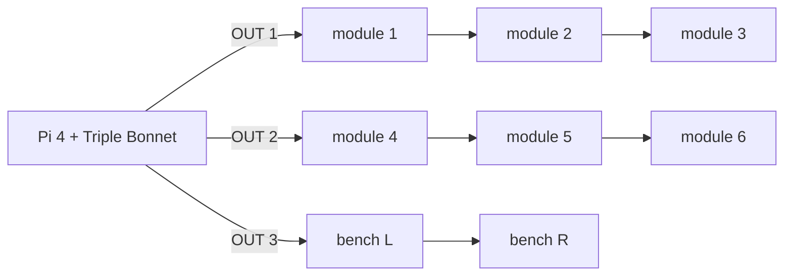
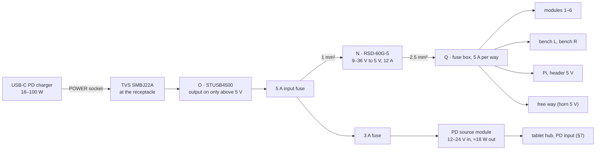
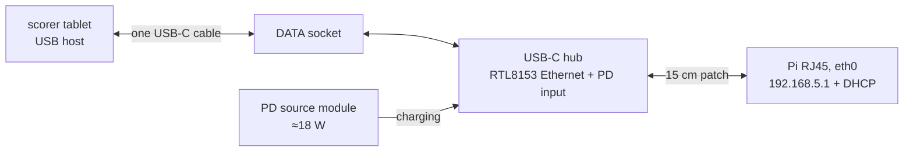

# Point Hub board — DIY scoreboard build guide (KSCW)

How KSC Wiedikon builds its own scoreboard from open parts: the same 192 × 64 pixels as the
Tech4Sport LedBox C0270 at **1.67× its pitch**, a small score panel facing each bench, powered by
**USB-C only** and driven by the same open software stack (bridge, console, openscore,
flushBuffer2).

**The illustrated build manual** — parts with letters A–Z, drawings for every step, a 3D view — is
here: **<https://claude.ai/artifact/Pezf9GMMEMuS1Kdg7xmxa8>** (draft of 22 October 2026). This page
is the reference behind it: the electrical design, the settings, the safety case and the software.
Where the two differ, this page is newer: the tablet-charging hub (§7) and the fold-out legs (§8)
were decided after the drawings were made.

> **Status, 22 October 2026: designed, not built.** openscore 1.0.0 has never run on real glass,
> and several pieces of software this box depends on are still to be written (§10.6). Treat every
> number here as a plan to be confirmed at the bench.
>
> Prices are **approximate, EUR, 2026**, incl. shipping/VAT where a European retailer exists.
> LED module and Raspberry Pi prices move a lot; check at purchase time. Orders from outside
> Switzerland add import VAT and fees — put them in as few parcels as possible.

This guide replaces the earlier recipe for a 1× panel (three 64×64 modules on a 230 V mains supply),
which is withdrawn; it is in the git history if you need it.

---

## 1. What it is

| | |
|---|---|
| Main screen | **192 × 64 LEDs at 5 mm pitch** (6 modules of 64×32, P5), 96 × 32 cm |
| Bench panels | **2 × (32 × 64)**: one P5 module per end, upright, facing the benches |
| Box | **102 × 38 × 22 cm**, 6 mm plywood, about **8 kg** |
| Front | 3 mm polycarbonate, tight on the LED mask |
| Power | **USB-C PD charger, 18–100 W**; 65 W or more for full brightness while charging the tablet |
| Ports | **2 × USB-C, nothing else**: POWER and DATA (to the scorer tablet: network + charging) |
| Wi-Fi | **out only**: the Pi's built-in radio joins the hall's Wi-Fi for internet; the board has no Wi-Fi network of its own |
| Mounting | table (straps), 35 mm speaker stand, tripod or light stand (¼″ or ⅜″, rated 12 kg+) |
| Horn | none fitted, wiring provisioned |
| Use | **indoor only** — the outdoor C0270 stays the beach board |
| Parts | about **CHF 950** at Swiss prices (October 2026), plus shipping |
| Build time | 12–15 h plus a day for paint to dry |

**Why this size.** Keeping 192 × 64 pixels means every existing layout renders unchanged; only
the pitch grows, from the C0270's ~3 mm to 5 mm. A score digit (fontsize 55, about 40 px) becomes
about **20 cm** tall instead of about 12 cm. A 1.5× box is not possible (there is no 4.5 mm pitch),
and 2× would mean twelve P3 modules with a 2× upscale: around €815 and more power than USB-C
delivers.

**The bench panels** show the score to each bench (own team on top, timeouts and substitutions).
openscore draws them itself from the live match sections, so the bridge, the console and the
protocol stay unchanged (§10.6).

**Software:**

```
console + bridge  ──TCP 8889──▶  openscore  ──buffer.png──▶  flushBuffer2  ──3 × HUB75──▶  8 modules
 (unchanged)                    (renderer)                  (panel driver, power governor)
```

---

## 2. Bill of materials

Letters match the illustrated manual. Quantities include the spares that live in the box
(2 modules, 4 fuses, 1 SD card).

| | Part | Spec | Qty | ~EUR |
|---|---|---|---|---|
| A–D, Y | Plywood | 6 mm poplar, one 1250 × 1250 sheet, store-cut (cut list §8) | 1 | 30 |
| E | Battens | 15 × 15, 2 × 1008 + corner blocks | 1 set | 5 |
| F | Steel bars | 20 × 3 × 368, galvanised — must be steel, the module magnets hold on them | 3 | 6 |
| G | Polycarbonate | 3 mm, **smoked grey** (about 50 % light transmission); 990 × 350 + 2 × 172 × 332 | 3 | 40 |
| H | LED module | P5 64 × 32 indoor, to the purchase spec in §3; 8 + 2 spare, one batch (about CHF 18.50 each on AliExpress, Oct 2026) | 10 | 185 |
| I | Raspberry Pi 4 | **1 GB** is enough (CHF 34.90 when in stock); out of stock everywhere in Oct 2026, so the 2 GB (CHF 60) | 1 | 60 |
| J | Driver board | **Adafruit Triple LED Matrix Bonnet (6358)**, 3 HUB75 outputs | 1 | 14 |
| K | Stacking header | 40-pin, tall, between Pi and bonnet | 1 | 3 |
| M | microSD | 32 GB, prepared image; one spare | 2 | 14 |
| N | Converter | **Mean Well RSD-60G-5**: 9–36 V in, 5 V 12 A (60 W) out | 1 | 55 |
| O | USB-C PD sink board | **STUSB4500** (e.g. SparkFun DEV-15801, contract-gated output) | 1 | 30 |
| P | USB-C panel sockets | panel mount, 30 cm, data-rated (not charge-only) | 2 | 14 |
| Q | Fuse box | 12-way **standard blade (ATO/ATC)** with a negative bus, 14 × 5 A fuses (4 spare); a 12-way MINI box with a negative bus was not on sale in Oct 2026 | 1 | 30 |
| R | Horn switch | MOSFET board + **TCA9534** I²C output breakout + 10 kΩ gate pull-down + plug, no horn | 1 | 7 |
| S | Stand cup | 35 mm, with M4 screws | 1 | 8 |
| T | Tripod threads | 2 × M10 T-nut + K&M 21980 adapter (M10 → ⅜″-16), one with a K&M 21770 reducer (⅜″ → ¼″-20); inch wood inserts are not sold in CH | 2 | 22 |
| U | Rubber feet | | 4 | 3 |
| V | Handles | black bow handles, 128 mm | 2 | 8 |
| W | Corner caps | black rubber, 20 mm, front corners only | 4 | 5 |
| Z | Blanking plug | Ø30, for the horn hole | 1 | 2 |

| Small parts and wire | Spec | ~EUR |
|---|---|---|
| Screws and fittings | 66 × wood screw 3.5 × 16 T20 (6 hold the back panel), 12 × M4 × 16 T20 + nuts, 4 × M2.5 standoffs, 8 turn buttons | 8 |
| Straps | 2 × Velcro strap with buckle, 50 mm × 1 m | 8 |
| Stickers | "POINT HUB" cut-vinyl lettering for the front, back label for the ports | 15 |
| Tablet hub | small USB-C hub with **Ethernet (RTL8153)** and a **USB-PD pass-through charging input**, + 15 cm patch cable | 25 |
| Tablet charging module | USB-C PD source, 12–24 V in, about 20 W PD out: a bare module (SW3518-type buck) where available, or a 12–24 V USB-C car charger with its plug cut off, wired to the fused input | 10 |
| Clock + temperature | DS3231 RTC (breakout without a charging circuit) + SHT40 sensor breakout | 10 |
| Aluminium plate | 200 × 150 × 2, under the converter and the fuse box | 6 |
| Protection | 5 A inline fuse + holder, 3 A fuse + holder, TVS diode SMBJ22A (through-hole equivalent: **P6KE27A**, not P6KE22A, whose standoff is only 18.8 V), 10 kΩ resistor, snap-on ferrites | 6 |
| Wire | red + black: 2.5 mm² 1 m, 1 mm² 2 m, 1.5 mm² for extensions; ferrules; Wago 221 | 8 |
| Paint, glue | matte black for the box, gloss black for the front face, two coats each; wood filler, 120-grit sandpaper; wood glue | 16 |
| Fold-out legs *(optional)* | 2 hinges with stops; the legs come out of the plywood offcut | 10 |
| **Total** | | **≈ 550** |

The €-figures above were the first estimate, at AliExpress and EU prices. Bought in Swiss shops in
October 2026 the full list comes to about **CHF 945, plus CHF 50–90 shipping** (the shopping list has
every item, shop and price). The biggest differences: the modules (CHF 185), the smoked
polycarbonate (CHF 89), paint and filler (about CHF 78) and the Pi (CHF 60, the 1 GB is sold out).
Connectors, ferrules, wire, magnets and inserts from AliExpress, and turn buttons cut from the
offcuts, bring it to about CHF 850.

**Tools** — all of it fits a normal home toolbox: drill/driver with T10 + T20 bits; wood drill
bits Ø2.5, 3.2, 4.5, 8, 12; hole saws Ø30 and Ø45; jigsaw with a fine wood blade; two clamps; ruler,
pencil, masking tape; crimp tool for ferrules; multimeter; a **USB-C power meter** (about €12) —
it is needed for the first power-up and to calibrate the power governor.

The spares and fallback kit that goes with the box (charger, flip board, …) is in §11.

---

## 3. LED module purchase spec

Cheap P5 listings rarely name the driver chip, and some chips cannot be driven by the
`rpi-rgb-led-matrix` library at all. **Get this in writing from the seller, with a photo of the
driver ICs on the back of a module, before paying:**

| | Require | Why |
|---|---|---|
| Module | **P5, 64 × 32, indoor**, HUB75 IN + OUT, own 5 V power lead | 320 × 160 mm each; six make the 960 × 320 screen |
| Scan | **1/16**, direct **A–D** row addressing | standard for 64×32 P5; no E line needed |
| Driver IC | plain constant-current: **ICN2037, SM16208, FM6124, DP5125** (ICN2038S or FM6126A also work, possibly with `--led-panel-type=FM6126A`) | the library drives these |
| Refuse | **S-PWM drivers: ICN2153, FM6353 / FM6363 / FM6373, SM16380, DP3264** | not supported by the library — a whole order could stay dark |
| LEDs | **black-body SMD2121**, black mask (not white-body SMD3528) | off pixels stay black under hall light, at no power cost |
| Brightness, angle | ≥ 1000 nits, ≥ 140° | readable from the sideline |
| Batch | **all 10 from one production batch** | modules from different batches differ visibly in colour and brightness; a seam runs through the score digits |
| Mounting | magnets on the back (or order M3 magnet standoffs from the same seller) | the modules hang on steel bars, no screws |

Avoid 1/8-scan "outdoor" P5 modules (they may need multiplexing calibration nobody has done) and
skip GOB modules — the polycarbonate front already takes the ball. Note each listing's maximum
power: these modules are typically listed around **25 W each at full white**, which is why the
power governor (§5.5) is not optional.

**Bench-test one module on the Pi as soon as the parcel arrives, before cutting the case** (§10.2).
Sellers change chips between batches under the same listing.

---

## 4. Outputs and GPIO plan

### 4.1 Three outputs × three modules



| Output | Modules | Canvas rows |
|---|---|---|
| OUT 1 | 1 → 2 → 3, the **top row**, left to right | 0–31 |
| OUT 2 | 4 → 5 → 6, the **bottom row**, left to right | 32–63 |
| OUT 3 | **bench L → bench R**, third slot empty | 64–95 |

The driver runs `--led-rows=32 --led-cols=64 --led-chain=3 --led-parallel=3`: a **192 × 96**
canvas whose top 192 × 64 is the unchanged scoreboard. The library needs the same chain length on
every output, so OUT 3 is a chain of three with one slot unpopulated; that costs no refresh, because
the outputs are clocked in parallel. All module arrows point the same way (data direction); the
bench modules stand upright, arrows up. Which canvas slot lands on which end, and the rotation of
the bench content, is checked on glass with the module-number test (§10.4).

**The trade-off.** Three outputs keep 192 pixels per row, the fastest way to drive eight modules
from this bonnet. The price is that OUT 3 uses the I²C1 and UART pins. The alternative — two
outputs × four modules (`--led-parallel=2 --led-chain=4` with the library's `Remap` pixel mapper,
one bench module at the end of each chain) — frees those pins at about 25 % less refresh. Switching
is only ribbons and flags; measure both with `--led-show-refresh` if the three-output refresh ever
disappoints.

### 4.2 Pin plan

With 1/16-scan modules and three outputs, every GPIO from 2 to 27 is taken by the panels: GPIO15 is
the bonnet's HUB75 **E** line, unused on these modules but still wired to the ribbons. What is left —
**GPIO0/1** — carries everything else, the horn included:

| Use | GPIO (header pin) |
|---|---|
| Shared panel lines | OE− **18** (12), CLK 17 (11), LAT 4 (7), A–D 22 (15), 23 (16), 24 (18), 25 (22) |
| OUT 1 data | 11, 27, 7, 8, 9, 10 |
| OUT 2 data | 12, 5, 6, 19, 13, 20 |
| OUT 3 data | 14, 2, 3, 26, 16, 21 — this is why I²C1 and the UART are gone |
| **I²C0** | **GPIO0 (27) SDA, GPIO1 (28) SCL**: STUSB4500 `0x28`, SHT40 `0x44`, DS3231 `0x68`, horn switch TCA9534 `0x20` |
| **Horn switch** | TCA9534 output P0 → gate of the MOSFET board (R), 10 kΩ gate pull-down |
| GPIO15 (10) | **leave alone**: the bonnet's E line |
| Pi power | 5 V on pins 2/4, GND on pin 6, from its own fuse (§5) |

Rules that come with it:

- **I²C on GPIO0/1** (`dtparam=i2c_vc=on`, §10.1). These pins have no fixed pull-ups (GPIO2/3 do),
  so use breakouts that carry their own. Keep every device off `0x50–0x57`: the Pi probes there for
  a HAT ID EEPROM at boot.
- **No serial console.** GPIO14 is OUT 3's first data line: `enable_uart=0` and no
  `console=serial0` on the kernel command line. Recovery is over the DATA cable (SSH) or by swapping
  in the spare SD card.
- **OE pull-up: a 10 kΩ resistor from GPIO18 (pin 12) to 3.3 V (pin 1)**, on the Pi side of the
  bonnet's buffers, plus `gpio=18=op,dh` in `config.txt`. GPIO18 defaults to pull-down, which means
  "panels on" for the whole boot (about 45 s on the C0270) while the modules hold random data. Eight modules lit at
  random can draw more than a small charger delivers; the rail sags, the Pi browns out and reboots,
  and the cycle repeats. The resistor keeps them dark from the first millisecond; the `config.txt`
  line only takes effect a few seconds after power-on.
- **Horn through the I²C bus, not a GPIO.** GPIO15 would be the only candidate, but the Triple
  Bonnet buffers it onto HUB75 pin 4 or 8 as the **E** line, and on 1/16-scan modules those pins
  are usually **GND**: driving it high would push the buffer into a short. So the horn MOSFET hangs
  off a TCA9534 output expander on the I²C0 bus. Its outputs power up as inputs, and the 10 kΩ
  pull-down keeps the MOSFET off until software switches it. The output register powers up as
  `0xFF`, so clear it **before** making P0 an output: `i2cset -y 0 0x20 1 0x00`, then
  `i2cset -y 0 0x20 3 0xFE`; after that `… 1 0x01` sounds the horn and `… 1 0x00` stops it (bus 0
  is GPIO0/1 on a Pi 4; confirm with `i2cdetect -l`). With no horn fitted,
  openscore's `horn_cmd` stays empty (Horn commands still answer `ok`).
- The **tall stacking header (K)** is what makes pins 1, 12, 27 and 28 reachable under the
  bonnet.
- Do **not** copy the C0270's `applicon` mapping (its E line moved to GPIO26 — Tech4Sport's own
  wiring). The Triple Bonnet uses the library's stock **`regular`** mapping.

---

## 5. Power

### 5.1 The power path

Nothing in the box runs on mains, and there is no battery inside. Everything comes through the
POWER socket from a USB-C PD charger (or a PD power bank) and is fused before it goes anywhere.



- **TVS at the socket.** The SMBJ22A goes across VBUS and GND at the receptacle side of the PD
  board, ahead of its MOSFET: hot-plug ringing happens at the connector, not behind the converter.
  All bulk capacitance sits **behind** the contract-gated MOSFET.
- **5 A input fuse** between the PD board's gated output and everything else.
- **−Vin bonded to −V on the converter.** The RSD-60G-5 is isolated, but the PD board on its input
  side talks I²C to the Pi on its output side, so they need a common ground.
- **Converter and fuse box on the aluminium plate** (at least the size of the datasheet's mounting
  plate). The datasheet rates full load to +55 °C, or +70 °C on such a plate; the plate also makes a
  non-combustible tray.
- **Tablet charging module** taps the fused input (behind the 5 A fuse) through its own 3 A fuse and
  feeds the hub's charging input (§7). It needs ≥ 12 V, so on a 9 V contract it simply stays off.
- **Every module, each bench module and the Pi on their own 5 A fuse.** The tenth way stays free
  (the horn's 5 V if one is ever fitted).
- The Pi takes its 5 V on the header pins over a short pair of its own; its USB-C socket stays empty.
  Never power panels through the Pi or the bonnet: the ribbons carry logic only.
- A snap-on ferrite on the input lead, and flat-cable ferrites on the ribbons at the bonnet end;
  keep ribbons short and 5 V leads away from them.

### 5.2 STUSB4500 settings (NVM, program once)

| Setting | Value | Why |
|---|---|---|
| `power_above_5v_only` | **on** | the output stays off until a ≥ 9 V contract exists: a 5 V-only source (USB-A, a plain 5 V port) leaves the box **completely off** instead of half-booting the Pi, and the converter never sees 5 V |
| PDO2 | **9 V / 2.0 A** | 18–27 W chargers land here |
| PDO3 | **20 V / 1.5 A** | a 30 W charger lands on 20 V/1.5 A instead of 9 V |
| `req_src_current` | **on** | request the charger's full current at the matched voltage, so a 65 W charger gives 20 V/3 A or more |

The NVM has limited write cycles: program it once, on the bench. The Pi reads the negotiated
contract from `RDO_STATUS` (register `0x91`) every 1–2 s over I²C and turns it into the LED budget
(§5.5). The chip's ALERT line is not wired (no free GPIO), so it polls.

### 5.3 What each charger gives

| Source | Contract | Result |
|---|---|---|
| 5 V only (USB-A, phone charger without PD) | none | box stays off — by design |
| 18–27 W, 9 V | 9 V, 2–3 A | runs dimmed; tablet charging off (needs ≥ 12 V) |
| 30 W | 20 V, 1.5 A | runs; little is left for the LEDs once the tablet charges |
| **65 W or more** | 20 V, 3 A + | **full brightness with the tablet charging** — the recommended charger |
| 100 W with a 5 A (e-marked) cable | 20 V, 5 A | most headroom; the converter itself stops at 60 W |

Operating rules: a **single-port** charger labelled "board only" — a multi-port charger
re-negotiates when something else is plugged in, and the box reboots. A power bank must offer
**20 V at ≥ 2.25 A** (45 W class or more), otherwise the box falls back to 9 V and dims. Swapping
chargers mid-match means a reboot; the match resumes where it was.

### 5.4 Wiring rules

- Red = +, black = −, everywhere; a ferrule on every wire end. Never swap + and −.
- PD board → 5 A fuse → converter input: **1 mm²**. Converter output → fuse box: **2.5 mm²**
  (anything ≥ 1.5 mm² is enough). Branches ≥ 0.75 mm²; extend a module lead that does not reach with
  1.5 mm² and a Wago 221.
- **Fuse every branch at ≤ 5 A** (why: §6). Label each power plug (1–6, L, R, Pi) to match a fuse
  map printed on the inside of the back panel.
- Leave **15 cm of slack** on every cable so the back panel can come off.

### 5.5 Power budget and the governor

Eight modules at roughly 25 W each could ask for **about 200 W** at full white — more than three
times what the converter delivers (60 W) and ten times a 9 V/2 A charger (18 W). A white-heavy
frame or a test pattern would trip the charger, reset the PD contract and reboot the box mid-match.
So the panel is never allowed to draw what the content asks for:

- **LED budget = negotiated contract − Pi (≈ 5 W) − tablet allowance − margin.** The tablet
  allowance is about 18 W whenever the charging module runs (a 20 V contract) and zero on 9 V. The
  budget is also capped at what the converter can deliver after the Pi, and so that no module draws
  more than about 75 % of its 5 A fuse.
- **The governor lives in flushBuffer2**, the last stage before the glass, so it covers every
  renderer, test pattern and bug. Per frame it estimates the current from the duty actually shown
  (the library's CIE-corrected brightness, not raw pixel values), picks the highest brightness at or
  below the requested one that fits the budget, limits how fast brightness rises (for example
  +5 % per frame) and fades in over 1–2 s at boot. The appliance writes the budget to a small control
  file in `/run`; flushBuffer2 applies it live with `SetBrightness`, no restart.
- **Calibrate once per build**: show full red, green, blue and white and compare the estimate with
  the USB-C power meter.
- **Backstops**: the Pi's under-voltage flag (already read for Diagnostics) cuts the budget by 20 %;
  the SHT40 inside the box ramps brightness down from **50 °C** and blanks the panel at **60 °C**.
- The console header should show the contract ("PD 9 V 2 A, 18 W") so a weak charger explains a
  dim board.

**None of this is written yet** (§10.6). Until it is, bring the box up only at low brightness with
mostly black content, and do not take it to a match.

---

## 6. Safety case

The box is low-voltage only (at most 20 V from a certified charger), so the realistic hazards are a
persistent fault that heats a wire or the converter, overheating in the sun, and mechanical damage.

**Electrical faults.** The charger bounds the input power to the negotiated contract, and the 5 A
input fuse bounds it again. Inside, the RSD-60G-5 does **not** hiccup on overload: it limits current
at 105–135 % (about 12.6–16 A) and recovers by itself, so a resistive fault can sit at ~60 W
indefinitely. That is why every branch has its own **5 A** blade fuse: it opens in 0.15–5 s at
200 % and in under 0.5 s at 350 %, where a 7.5 A fuse could hold for minutes. The converter's output
over-voltage protection (5.75–7 V) latches off, so a failed converter cannot cook the Pi and the
modules. The metal plate under converter and fuses is the non-combustible tray.

**Heat.** At the power cap the box turns at most ~60 W into heat, an estimated 12–15 K above the
hall temperature inside a closed plywood box. **Direct sun is a different league** — an estimated
30–50 K more on the dark front — past the modules' typical 50–60 °C limit, the converter's 55 °C
full-load point and the Pi's throttle. Hence the rules: **never in direct sun or next to a sunny
window**, indoor only, the vents in the back panel kept clear (if the soak test runs warm, add a
row of vents low in the back panel as well), and the SHT40 derating at 50 °C / blanking at 60 °C.

**At boot.** The OE pull-up keeps the panels dark until the driver runs (§4.2).

**Mechanical.** A spiked ball (about 270 g at 20–30 m/s) can crack acrylic into shards;
**polycarbonate** does not shatter. That is the reason for the PC front — impact, not fire (neither
material is UL94 V-0 at 3 mm). On a table the straps hold the box against a hit from the court; on
a stand, use a stand rated 12 kg or more and a sandbag on its feet.

**Climate.** Coming in from a cold car: wait **45 minutes** (60 below 0 °C) before switching on, or
condensation can short the modules. A sachet of silica gel lives in the box.

### Bench checklist — before the first match, and after any hardware change

1. **First power-up** with a small 9 V charger and nothing connected but the converter: 5.0–5.2 V at
   the fuse box (step 12). A 5 V-only source must leave the box off.
2. **Soak: 2 h at the power cap** with thermocouples on the converter, a module back and the Pi (a
   borrowed thermal camera is a bonus). Log the SHT40 alongside.
3. **Fuse-clear test** on every branch: short it through a 0.2 Ω load; its fuse must open.
4. **Ball test**: a spike from 3 m onto the front.
5. **Drop test**: 50 cm onto a corner, back panel on, in transport configuration.
6. **Link test**: the tablet at about 10 m, ping/load the console with the panel at full cap and
   off — the panel must not knock out its own Wi-Fi or the cable.

Keep the results with the box: the fuse map inside the back panel, and a short record (schematic, fuse plan,
soak readings).

---

## 7. Tablet link (DATA port)

**One USB-C cable from the box to the scorer tablet carries the network and charges the tablet.**



- The DATA socket goes to a small **USB-C hub with Ethernet (RTL8153) and a USB-PD pass-through
  charging input**. The hub's Ethernet runs over a 15 cm patch cable to the Pi's own RJ45, which
  serves **`192.168.5.1`** and DHCP exactly like the C0270's cable. The tablet sees an ordinary USB-C
  Ethernet dongle (the RTL8153 shows up as `eth0`, which Android adopts) and is charged through the
  same cable by the PD source module (§5.1), up to about 18 W.
- **The cable is the only way in.** The board has no Wi-Fi network of its own (owner decision,
  22.10.2026: the board connects out to the internet; nothing connects in over the air). The scoring
  tablet, a laptop running OpenVolley, or the club laptop for setup and repairs take the DATA cable,
  one at a time. Remotely, the board is reached over Tailscale once it is online.
- A device on the cable is **trusted without the scorer PIN** (the console's cable trust: on by
  default, `CABLE_TRUST=0` switches it off). Wi-Fi never reaches the console, so the PIN only guards
  Tailscale access.
- **If the tablet or the cable fails mid-match** there is no phone fallback: keep scoring on the flip
  board (§11), which the rules require anyway, and swap in the laptop on the cable.
- **Never connect the DATA port to a hall network switch.** It hands out addresses and, once the
  change above lands, grants PIN-free control.
- The tablet charges only on a 20 V contract (the charging module needs ≥ 12 V); on a 9 V charger
  the data link still works and the tablet runs on its battery.
- **Bench-test with the club's real Galaxy Tab A before cutting the case**: the tablet must work as
  USB host (Ethernet up, console on `http://192.168.5.1:8890`) **and** charge through the hub at the
  same time. If it cannot, fall back to a plain RTL8153 adapter (data only) and give the tablet its
  own charger.
- Order the panel socket to match the hub: if the hub has a captive plug, the inside end of the DATA
  socket must be a USB-C **receptacle**. Every part on this path must pass data and PD.
- **Why not USB gadget mode on the Pi?** On the Pi 4 the USB-C gadget port is also its power input,
  which would tie the tablet's 5 V to the converter's; and Android ignores a gadget link named `usb0`.
  The Pi's own USB-C socket stays empty.

POWER and DATA are both on the back, colour-ringed (gold POWER, blue DATA) and labelled.

---

## 8. The case

### Sheets and thicknesses

| Material | Thickness | What it becomes |
|---|---|---|
| Poplar plywood, B/BB, indoor glue | **6 mm** | the shell: front frame, back panel, top, bottom, ends (A–D) |
| the same plywood, two layers glued | **12 mm** | the backing plate (Y) and the two tilt legs: screws and bolts need more than 6 mm |
| Smoked polycarbonate (G) | **3 mm** | the front sheet and the two end sheets |
| Pine battens (E) | **15 × 15 mm** | the shell joints, the six back-panel screw blocks, the corner blocks |
| Steel flat bar (F) | **20 × 4 mm** | the three bars the module magnets hold on to |
| Aluminium sheet | **1.5 mm** | the plate under the converter and the fuse box |

### Cut list — one sheet of 6 mm poplar plywood, 1250 × 1250

(Or two 1200 × 600 sheets for A + C and B + C, and one 600 × 600 for D, Y and the legs.)

| Part | Size (mm) | Thickness | Notes |
|---|---|---|---|
| A front frame | 1020 × 380 | 6 | window **960 × 320**, 30 mm border all round |
| B back panel | 1020 × 380 | 6 | **screwed on, the way in**; ports, horn hole, vents, 6 screw holes |
| C top + bottom | 2 × 1020 × 208 | 6 | top: 4 × Ø4.5 for the handles; bottom: stand flange and tripod threads |
| D ends | 2 × 208 × 368 | 6 | window **160 × 320**, 24 mm border |
| Y backing plate | 2 × 208 × 140 | 6 + 6 | glued together and inside the bottom: the stand flange bolts (M8) and the T-nuts sit in 18 mm |
| L tilt legs | 4 × 40 × 50 | 6 + 6 | glued in pairs: two 12 mm legs, so the hinge screws hold |

Hand the list to the store saw (straight cuts only) or have the sheet laser-cut, windows included.
Birch instead of poplar adds about 1.5 kg. Polycarbonate (G) is sawn or CNC-cut, never laser-cut
(it melts).

**Cut-outs:** Ø45 stand flange, 2 × Ø12 for the M10 T-nuts (bottom) · Ø30 horn hole, plugged · Ø4 × 6
back-panel screws, countersunk · USB-C 13 × 7 + 2 × Ø3, twice · vents 8 × (40 × 8) along the top of the back panel.

### Design

- **Front:** 3 mm **smoked grey** polycarbonate (G, about 50 % light transmission) drops into the front
  frame from inside and sits **tight on the LED mask** (within 2–3 mm, so there is no halo or parallax
  from the side). The smoke hides the module grid and magnets, and roughly doubles the contrast in a
  bright hall, because room light passes the tint twice and the LEDs only once; run the brightness
  about a fifth higher than behind clear. The
  modules lie on it, recessed behind the 6 mm frame. Same for the two small end sheets. Keep the
  outer protective film on until the very end.
- **Modules on magnets:** three **steel bars** (F) are screwed across the two long battens; the
  modules' own magnets snap onto them. No screws — a module swaps out in seconds. The bench modules
  sit behind the end windows, arrows up, held by four turn buttons each.
- **Back panel, six T20 screws, no door:** the back panel (B) sits on six 15 mm blocks glued into
  the shell's back edge, flush with it (four corners, the middle of the top and of the bottom; batten
  offcuts), and is held by six 3.5 × 16 T20 wood screws. No hinges, hooks or inserts: cheaper, and
  nothing to work loose. It takes a tool on purpose — in a public hall, anything that opens by hand
  gets opened — and it is the same T20 as every other screw, so the key in the kit bag opens it.
  Everything inside is in reach once it is off. If it gets opened often and a hole wears, move the
  screw a few millimetres along the block. The back panel carries the **fuse map, four spare fuses
  and a spare SD card** on its inside.
- **Corners:** every outside edge is rounded with sandpaper (about 3 mm). The four front corners get
  **black rubber caps** against knocks in transport; the back corners stay bare, so the back panel
  lifts straight off.
- **Handles** (×2) on top. On a table, a **Velcro strap through each handle and around the table's
  back edge** keeps a ball hit from pushing the box off.
- **Bottom:** a **35 mm speaker-stand flange** (M8 bolts) and **⅜″-16 and ¼″-20 tripod threads** (M10 T-nuts with adapters)
  for tripods and light stands, on the glued backing plate (Y); four rubber feet.
- **Fold-out front legs (optional, about €10):** two 40 × 50 mm legs (12 mm: two layers glued) hinged under the
  **front** edge, 35 mm in from it and 300 mm either side of the middle, each with a stop at 90° to the bottom. Folded,
  they lie flat between the feet. Out, they lift the front 5.5 cm: the box leans back on its back feet
  and the screen tilts **15° up**, towards the first referee on the raised stand across the court
  (from a scorer's table about 10 m away, the referee's eyes are 10–15° above the board). Tilted, the
  box tips backwards more easily: keep the strap on. The bench screens lean with the box (15°): the
  numbers stay easy to read, and nothing in the software changes. Raising the whole box on
  a stand is the bigger win, though: it also clears the heads of people standing in front of it.
- **Torx throughout** (plain, not security Torx): T20 for the wood screws and M4 machine screws,
  T10 for the small parts. Pre-drill Ø2.5 near every edge.
- **Matte black** inside and out, two coats, so nothing reflects behind the LEDs — except the **front
  face, gloss black**: behind the smoked sheet, the screen and its 30 mm border then read as one black
  surface when the board is off. Fill the plywood grain on the front face first, or it shows through.
- **Stickers:** a light-grey matte cut-vinyl **"POINT HUB"** lettering (about 120 × 10 mm) on the
  bottom-right of the front border, and a small back label (about 80 × 40 mm: "Point Hub · KSC
  Wiedikon", POWER and DATA) beside the ports.
- **Electronics** lie on the bottom panel behind the modules: converter and fuse box on the
  aluminium plate; Pi and bonnet on M2.5 standoffs; the PD board by the POWER socket, the hub and the
  charging module by the DATA socket; RTC and temperature sensor; the horn switch by the plugged horn
  hole. **Put the Pi close to the back panel**: its built-in Wi-Fi is the board's only internet link,
  and its antenna cannot see through the modules and the steel bars, while plywood lets the signal
  out. Keep USB 3 devices off the blue ports if the hall uplink is weak (USB 3 traffic is noisy on
  the 2.4 GHz band).

---

## 9. Build steps

Seventeen steps in four stages; the drawings are in the
[illustrated manual](https://claude.ai/artifact/Pezf9GMMEMuS1Kdg7xmxa8).

**A — Case** (about 5 h plus a day to dry)

1. **Cut the parts** — seven rectangles from one sheet (cut list, §8).
2. **Cut windows and holes** — drill each window corner, join with the jigsaw; round holes with a
   hole saw. Masking tape on the cut line, good side down. Check the USB-C cut-outs against the
   sockets that actually arrive.
3. **Glue the shell** — bottom, ends, top and front frame onto the battens, glued and screwed. The
   back panel stays loose: glue the six screw blocks into the back edge (corners and the middle of
   top and bottom, flush), and screw the panel on last (step 15).
4. **Fit the bottom** — box upside down; glue in the backing plate, then the stand cup, the two
   tripod threads and the four feet (and the fold-out legs, if fitted).
5. **Paint** — round every outside edge (120 grit), then two coats of matte black, inside too; the
   front face gloss black.

**B — Panels** (the box lies face-down on a blanket)

6. **Front sheet in** — peel the inner film off the polycarbonate and drop it into the front frame;
   same for the two end sheets.
7. **Six modules** — LEDs down, all arrows the same way; short ribbons 1 → 2 → 3 and 4 → 5 → 6. Leave
   the IN of modules 1 and 4 free for the bonnet.
8. **Bars across** — screw the three steel bars into the battens; the module magnets snap on.
9. **Bench panels** — one module behind each end window, arrows up, four turn buttons each. Stand
   the box upright again.

**C — Electronics** (low voltage only — nothing in here can give you a shock)

10. **Lay out the electronics** on the bottom panel (§8); fit both USB-C sockets in the back panel now.
    Solder the 10 kΩ OE pull-up (§4.2).
11. **Power wiring** — POWER socket → PD board → 5 A fuse → converter (1 mm²) → fuse box (2.5 mm²);
    the TVS across the socket's + and −; −Vin bonded to −V; the charging module behind its 3 A fuse.
12. **First power-up** — nothing else connected; a small (about 20 W) PD phone charger into POWER,
    through the USB-C power meter (it should read 9 V); 5.0–5.2 V at the fuse box. 0 V or −5 V:
    unplug and check + and −. A weak charger is the safety net here.
13. **Connect everything** — each module, each bench module and the Pi to its own 5 A fuse; ribbon
    OUT 1 → module 1, OUT 2 → module 4, OUT 3 → bench L → bench R; I²C to pins 27/28; DATA socket →
    hub → patch cable → Pi network port; charging module → hub.
14. **Test** — back still open, prepared SD card in, a laptop charger on POWER: a test pattern on all
    eight modules for 30 minutes, under the power governor (or at low brightness until it exists).
    Warm is fine; hot or smelly → unplug. The full bench checklist (§6) follows before the first
    match.

**D — Finish**

15. **Close up** — put the back panel on and drive in its six T20 screws. Handles
    on top, a black rubber cap on each front corner, the plug in the horn hole.
16. **Set it up** — on the table with a strap through each handle around the table's back edge, on a
    speaker stand, or on a tripod or light stand (sandbag on its feet). Charger into POWER, the
    tablet cable into DATA.
17. **Open it** — unplug the charger, undo the six T20 screws, lift the back panel off.
    Swapping the SD card or a fuse takes under a minute.

---

## 10. Software bring-up

### 10.1 Prepare the Pi

Flash **Raspberry Pi OS Lite, 64-bit**. (The C0270's 32-bit userland is stuck on Node 22, which ends
in April 2027; a new board should not start there.) Then:

```ini
# /boot/firmware/config.txt
dtparam=audio=off                    # on-board audio PWM collides with the panel driver
enable_uart=0                        # GPIO14 is OUT 3
dtparam=i2c_vc=on                    # I²C0 on GPIO0/1 (pins 27/28)
dtoverlay=i2c-rtc,ds3231,i2c0        # DS3231 on I²C0
dtoverlay=i2c-sensor,sht4x,i2c0      # SHT40 on I²C0
gpio=18=op,dh                        # OE− high early: panels dark (second layer after the pull-up)
```

```bash
# keep the sound module out for good (an OS update must not bring it back)
echo "blacklist snd_bcm2835" | sudo tee /etc/modprobe.d/blacklist-rgb-matrix.conf

# /boot/firmware/cmdline.txt is one line: remove console=serial0,115200 and append
#   isolcpus=domain,managed_irq,3 nohz_full=3 rcu_nocbs=3 irqaffinity=0,1,2
# (core 3 for the panel's refresh thread); after a reboot:
cat /sys/devices/system/cpu/isolated      # → 3
```

Check the overlay parameters against `/boot/firmware/overlays/README` on the image you flash, then
confirm the bus: `i2cdetect -l` lists I²C0, and the STUSB4500 (`0x28`) answers on it while the RTC
and the sensor show as bound by their drivers. Drop `fake-hwclock` once the DS3231 keeps time; fit
the coin cell only on a breakout **without** a charging circuit (or remove the charging
resistor/diode of the common ZS-042 module) and power it from 3.3 V.

**Networking:**

- Wi-Fi country **CH** (`raspi-config`).
- **One radio, client only.** The built-in radio joins the hall's Wi-Fi, with the captive-portal
  login as on the C0270, plus the low-priority phone-hotspot fallback profile. No access point: no
  hostapd, and dnsmasq serves `eth0` only. `provisioning/setup-wlan1-client.sh` and the console's
  hall login (`src/hallLogin.js`) assume the uplink is `wlan1`, so name the built-in radio `wlan1`
  with a systemd `.link` file (`[Match] Driver=brcmfmac`, `[Link] Name=wlan1`) and both work
  unchanged.
- The board gets **its own identity** (`boardId` and label in settings.json) — never the C0270's,
  and never "LedBox": that is Tech4Sport's product name. Call it **Point Hub**.
- Idle screen: set `idleQr` off — there is no board network to join, so the crest and clock show
  instead of the connect QR codes.
- `eth0`: **192.168.5.1/24 with a DHCP server** for the tablet (§7).

### 10.2 Driver library, first light

Build `rpi-rgb-led-matrix` at the commit pinned in
[`firmware/flushbuffer/build.sh`](../../firmware/flushbuffer/build.sh), so the demos and
flushBuffer2 use the same library:

```bash
sudo apt install -y git build-essential
git clone https://github.com/hzeller/rpi-rgb-led-matrix && cd rpi-rgb-led-matrix
git checkout 51d3231e370593b60952b2c3b18d2e3802329f18     # = RGB_SHA in build.sh
make -C examples-api-use
```

**One module first**, on OUT 1, before anything is cut: `--led-chain=1 --led-parallel=1` with the
flags below. A rotating square that looks right means the chip, the scan and the bonnet are good.

### 10.3 The flags — start from vendor profile C and measure

```bash
sudo ./examples-api-use/demo -D0 \
  --led-rows=32 --led-cols=64 --led-chain=3 --led-parallel=3 \
  --led-gpio-mapping=regular --led-multiplexing=0 --led-row-addr-type=0 --led-scan-mode=0 \
  --led-pwm-bits=7 --led-pwm-lsb-nanoseconds=180 --led-pwm-dither-bits=2 \
  --led-slowdown-gpio=3 --led-brightness=40 --led-show-refresh
```

| Flag | Start value | = panel property |
|---|---|---|
| `--led-rows` / `--led-cols` | `32` / `64` | one 64×32 module |
| `--led-chain` | `3` | three modules per output (OUT 3: two plus an empty slot) |
| `--led-parallel` | `3` | three outputs → 192 × 96 canvas |
| `--led-gpio-mapping` | `regular` | the Triple Bonnet's pinout — **not** the C0270's `applicon` |
| `--led-multiplexing` | `0` | indoor 1/16-scan modules; sweep only if the image is scrambled |
| `--led-row-addr-type` | `0` | direct A–D addressing |
| `--led-scan-mode` | `0` | the library default; flushBuffer2 compiles in `1` for the C0270, so pass it |
| `--led-pwm-bits` | `7` | vendor profile C |
| `--led-pwm-lsb-nanoseconds` | `180` | vendor profile C |
| `--led-pwm-dither-bits` | `2` | vendor profile C |
| `--led-slowdown-gpio` | `3` | vendor profile C (Pi 4) |
| `--led-brightness` | `40` for bring-up | later owned by the console and the power governor |
| `--led-panel-type` | only `FM6126A` for those chips | |

**Start from vendor profile C and measure — do not copy the C0270's tuning.** Tech4Sport's own
table ([`firmware/setting.ini.example`](../../firmware/setting.ini.example)) has profile **C (Pi 4,
indoor)**: lsb 180, slowdown 3, multiplexing 0. The C0270 runs profile **D** (outdoor: lsb 450,
slowdown 5, multiplexing 1), which is wrong for indoor modules and wastes much of each frame on
dark-but-timed PWM planes at low brightness. Then, with `--led-show-refresh` running for a few
minutes (Wi-Fi traffic included):

- try `--led-slowdown-gpio` 3 → 2 (the bigger lever); keep the fastest value without garble;
- lower `--led-pwm-lsb-nanoseconds` together with a higher brightness to recover dark time; watch
  for ghosting;
- **never** lower `--led-pwm-bits` at low brightness — it drops the only planes that are lit;
- then lock the refresh with `--led-limit-refresh` a little below the lowest rate observed, at a
  multiple of 100 Hz (200 or 400 Hz), so video at a 1/100 s or 1/50 s shutter shows no bands. A
  1/500 s shutter needs a minimum above about 520 Hz.

Record the result in `setting.ini` (`[DISPLAY]`), keeping the previous file to roll back.

### 10.4 Calibrate on glass

Geometry errors are invisible over the network — **look at the panel**:

- Scrambled pixels: sweep `--led-multiplexing` and `--led-row-addr-type`; confirm the driver chip
  against the purchase spec.
- A module upside down or a chain in the wrong order: check the arrows and the ribbons first.
- Bench panels: which canvas slot is which end, and the rotation, come from the **module-number
  test screen** (each module shows its number). If the three-output refresh disappoints, try the
  two-output `Remap` wiring (§4.1).
- Full-white soak for the power path only under the governor (§5.5).

### 10.5 Point the stack at it

```
console / bridge  ──TCP 8889──▶  openscore  ──www/buffer.png──▶  flushBuffer2  ──▶  panels
```

1. **flushBuffer2** — build it with [`firmware/flushbuffer/build.sh`](../../firmware/flushbuffer/build.sh)
   (it adds `applicon` but the stock `regular` is still there). It compiles in the C0270's
   64 × 64 × 3 geometry, so the Point Hub board's start script must pass `--led-rows=32 --led-cols=64
   --led-chain=3 --led-parallel=3 --led-scan-mode=0` along with the `setting.ini` tuning
   (`hardware_mapping=regular`, the values from §10.3).
2. **openscore** — the renderer ([`firmware/openscore/`](../../firmware/openscore/)) writes the
   192 × 64 `buffer.png`; flushBuffer2 shows it on the front, and the bench rows stay dark until
   openscore renders them.
3. **Console and bridge** — unchanged: `npm run appliance` on the board, the console on port 8890.

### 10.6 Still to build before the first match

| Piece | Where | Status |
|---|---|---|
| Power governor, live brightness, budget file in `/run` (§5.5) | flushBuffer2 | written 22.10.2026, not yet run on glass |
| PD contract read (`RDO_STATUS`) → budget; contract shown in `/api/status` and the console | appliance | **must** — not written |
| SHT40 derating 50 °C / blank 60 °C | appliance → budget | **must** — not written |
| Module-number test screen (bring-up, swap card) | openscore | **must** — not written |
| Text placement fix (openscore draws ~4 px high) | openscore, ROADMAP Phase 2 | before the first glass run |
| Bench screens: 192 × 96 canvas (or a `Remap` canvas of 256 × 64), content from the live match sections | openscore | feature — not written |
| Cable tablet trusted without the scorer PIN (§7) | console | done (cable trust, 22.10.2026) |
| Board identity (`boardId`, label; built 22.10.2026) and the client-only Wi-Fi setup (`.link` file, no AP) | provisioning | **must** |
| Read-only root with a persistent `/data` partition and a `STATE_DIR` setting | image, appliance | planned; until then the card stays read-write, because match state and the resume file must survive a power cut |

---

## 11. Spares kit and fallback

**In the box or the kit bag:**

- **2 spare modules from the same order** (H) — a module ordered a year later rarely matches.
- Spare **5 A fuses** (4, inside the back panel) and a 3 A fuse; the fuse map inside the back panel.
- A **pre-imaged spare SD card** (M) in a labelled case, refreshed with every image release.
- 2 spare HUB75 ribbons and 2 module power leads.
- One known-good **single-port PD charger, 65 W or more**, labelled "board only", with a labelled
  1 m USB-C cable (about €40).
- A **micro-HDMI to HDMI cable** (about €5) and a USB-C network adapter for the club laptop. The
  laptop on the DATA cable reaches everything the board serves (console, Diagnostics, `/logs`,
  SSH), but only once the Pi has booted far enough to bring its network up; the DATA port carries
  no picture (the Pi 4's USB-C has no video). For a Pi that will not boot: take the back panel off and
  plug a monitor into the Pi's micro-HDMI, next to the back edge, or swap in the spare SD card.
- A **T20 key** (L-key or small screwdriver) for the back panel.
- The USB-C power meter, a small torch, silica gel.
- A printed **swap card**.

**Swapping a module** (a few minutes): unplug the charger → take the back panel off → read the dead module's
number on the module-number screen or the map → photograph the cables → lift the module off its
magnets → move power plug and ribbons to the spare (the arrow is the data direction) → power on →
run the module-number screen → note the swap in the inventory. Dead pixels: swap at the hall;
repair with hot air at home, or bin the module — it costs less than an hour of volunteer time.

**Fallback when the board fails:**

- **A flip scoreboard with digits of at least 12 cm** stays in the kit (about €30–80). Swiss Volley's
  rules (RV, Art. 82 f) require the home team to provide a scoreboard with digits at least 12 cm
  high; regional associations may relax that (Art. 240), so confirm with SVRZ. A phone or a tablet
  cannot show 12 cm digits.
- **If the board dies mid-match:** keep scoring — the scoresheet is the official record and the
  tablet keeps the score. Tell the first referee and the scorer at the next stoppage, put up the
  flip board, then power-cycle the box (unplug 10 s, wait for the idle screen). Not back within
  2 minutes: play on with the flip board. Afterwards, export the log from Diagnostics.
- **Basketball:** the board is never the official game clock — it has no horn and its clock is
  network-timed. Use the hall's timer.

---

## 12. Hinweis: Nachbau, Haftung, Vorschriften

Diese Bauanleitung beschreibt ein Gerät, das der KSC Wiedikon für den eigenen Gebrauch baut. Sie ist
kein Produkt, wird ohne Gewähr veröffentlicht und ist keine Rechtsberatung.

- **Kleinspannung heisst nicht «ohne Vorschriften».** Die Niederspannungs-Erzeugnisverordnung (NEV)
  erfasst in der Schweiz auch Erzeugnisse unter 50 V Wechsel- bzw. 75 V Gleichspannung, also auch ein
  Gerät, das nur über USB-C versorgt wird.
- **Nachbau und eigener Gebrauch:** Wer das Gerät nachbaut, ist selbst Herstellerin im Sinne von NEV
  und EMV-Verordnung (VEMV) und für Sicherheit und elektromagnetische Verträglichkeit verantwortlich.
  Die VEMV gilt auch beim Betrieb.
- **Ausleihen:** Wer das Gerät Dritten überlässt – auch unentgeltlich –, kann es im Sinne der NEV in
  Verkehr bringen, wenn das im Rahmen einer Geschäftstätigkeit geschieht. Vor einem regelmässigen oder
  organisierten Verleih an andere Vereine oder Verbände beim ESTI nachfragen.
- **Betrieb:** nur mit einem zertifizierten USB-C-PD-Netzteil (höchstens 100 W); Sicherungen nie
  überbrücken oder durch stärkere ersetzen; nie in praller Sonne oder an einem sonnigen Fenster
  betreiben; vor dem Öffnen das Netzteil ausstecken; WLAN-Ländereinstellung CH.

---

## Sources (approximate, 2026)

- Illustrated build manual (drawings, parts A–Z, the 17 steps): <https://claude.ai/artifact/Pezf9GMMEMuS1Kdg7xmxa8>
- hzeller `rpi-rgb-led-matrix` (driver, flags, `regular` mapping, refresh tuning, CPU isolation) —
  <https://github.com/hzeller/rpi-rgb-led-matrix>, pinned commit in `firmware/flushbuffer/build.sh`
- Adafruit Triple LED Matrix Bonnet — <https://www.adafruit.com/product/6358>
- Mean Well RSD-60 datasheet — <https://www.meanwell.com/Upload/PDF/RSD-60/RSD-60-SPEC.PDF>
- STUSB4500 NVM settings: SparkFun DEV-15801 and the STUSB4500 CircuitPython library documentation
- LED driver chips, standard vs S-PWM — <https://github.com/board707/DMD_STM32/wiki/Led_drivers>
- Swiss Volley Reglement Volleyball (RV) 26/27, Art. 82 f and Art. 240
- This repo: vendor display profiles in [`firmware/setting.ini.example`](../../firmware/setting.ini.example);
  the measured C0270 in [`firmware/openscore/PANEL-AND-DIY.md`](../../firmware/openscore/PANEL-AND-DIY.md);
  the panel driver in [`firmware/flushbuffer/`](../../firmware/flushbuffer/)
